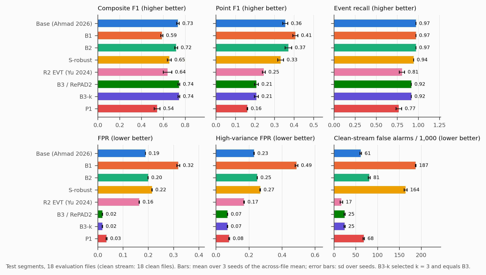
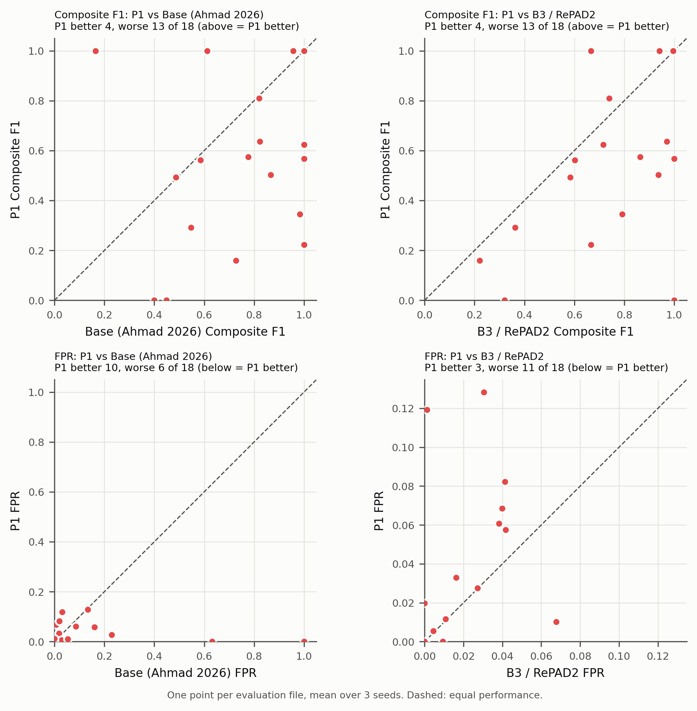
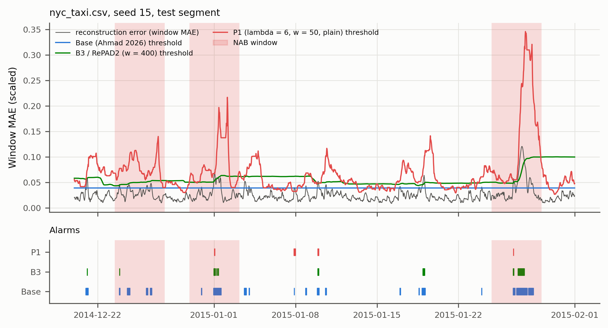
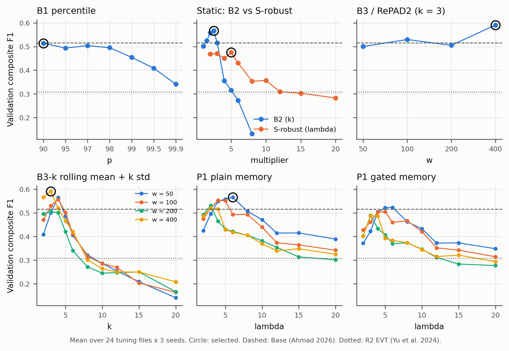
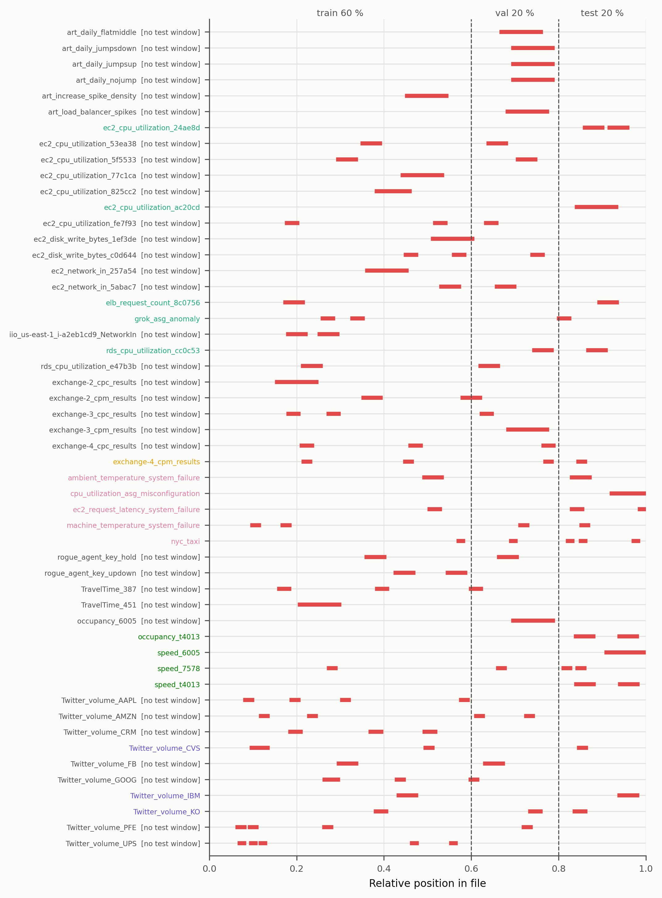

# Does Robust Adaptive Thresholding Help LSTM Autoencoder Anomaly Detection? A Leakage-Free Evaluation on NAB

LSTM autoencoders are often used to detect anomalies in cloud metrics, but the
rule that turns reconstruction error into an alarm gets little attention. A
recent AIOps preprint (Ahmad 2026) thresholds the error at the mean plus three
standard deviations of the training errors. This project tests whether a
rolling median plus a multiple of the median absolute deviation (MAD) does
better. Eight threshold rules are applied to the errors of one shared LSTM
autoencoder on the Numenta Anomaly Benchmark (NAB), under a leakage-free
protocol: chronological 60/20/20 split per series, training without labels,
every parameter tuned on validation data only, a single scoring of 18 test
series over three seeds, and hypothesis tests committed before any threshold
result existed. The result is negative. The base rule found almost every test
anomaly but flagged 18.9 % of normal points. Rolling rules cut that to 1.8 %
(RePAD2 rule) and 3.5 % (proposed rule), but the proposed rule did not beat
the rolling mean rule and was significantly worse than the base rule on
composite F1 (0.544 vs 0.733, Wilcoxon p = 0.035). None of the pre-registered
hypotheses was supported. For this model and benchmark, making the threshold
adaptive mattered; making it robust did not.

Paper: [paper/main.tex](paper/main.tex) (IEEE conference format; LaTeX
package for Overleaf in [submission/DSTT_paper_latex.zip](submission/DSTT_paper_latex.zip)).
Figures are mirrored to
[DSTT-Anomaly-Detection-images](https://github.com/zain0254/DSTT-Anomaly-Detection-images).

## Methods

All rules see the same reconstruction errors e(t) (per-window MAE of the LSTM
autoencoder) and alarm when e(t) exceeds the threshold.

| Method | Rule | Tuned on validation |
|---|---|---|
| Base (Ahmad 2026) | mean + 3 sd of training errors | nothing |
| B1 | p-th percentile of training errors | p |
| B2 | mean + k sd of training errors | k |
| S-robust | median + lambda * scaled MAD of training errors | lambda |
| R2 EVT (Yu et al. 2024) | generalized Pareto tail threshold of training errors (static part of Alg. 2) | nothing |
| B3 RePAD2 rule (Lee & Lin 2023) | rolling mean + 3 sd of the previous w errors | w |
| B3-k | rolling mean + k sd of the previous w errors | k, w |
| P1 (proposed) | rolling median + lambda * scaled MAD of the previous w errors, plain or gated memory | lambda, w, memory |

B2 vs S-robust and B3-k vs P1 are the equal-budget comparisons of Gaussian and
robust statistics. Definitions, grids and every design choice are in
[docs/decisions.md](docs/decisions.md).

## Results

Test segments of the 18 evaluation series; clean-stream false alarms on the 18
anomaly-free test segments. Mean ± sd over three seeds of the across-series
mean, from [results/phase3/test_summary.csv](results/phase3/test_summary.csv).
The full table, the hypothesis tests and the exploratory analysis are in
[docs/phase3_thresholds.md](docs/phase3_thresholds.md).

| Method | Selected | Composite F1 | Point F1 | Event recall | FPR | HV FPR | NAB first-step | Clean FA / 1000 |
|---|---|---|---|---|---|---|---|---|
| Base (Ahmad 2026) | - | 0.733 ± 0.011 | 0.355 ± 0.013 | 0.972 ± 0.000 | 0.189 ± 0.000 | 0.231 ± 0.001 | 72.0 ± 2.5 | 61.5 ± 1.9 |
| B1 percentile | p=90 | 0.587 ± 0.009 | 0.407 ± 0.013 | 0.972 ± 0.000 | 0.319 ± 0.006 | 0.488 ± 0.008 | 13.3 ± 6.8 | 187.3 ± 0.7 |
| B2 mean + k sd | k=2.5 | 0.718 ± 0.014 | 0.371 ± 0.017 | 0.972 ± 0.000 | 0.199 ± 0.000 | 0.250 ± 0.000 | 65.5 ± 2.9 | 81.1 ± 2.2 |
| S-robust median + lambda MAD | lambda=5 | 0.655 ± 0.018 | 0.332 ± 0.015 | 0.944 ± 0.000 | 0.215 ± 0.001 | 0.268 ± 0.002 | 44.6 ± 2.9 | 164.1 ± 3.3 |
| R2 EVT (Yu et al. 2024) | - | 0.639 ± 0.039 | 0.245 ± 0.007 | 0.806 ± 0.032 | 0.164 ± 0.001 | 0.171 ± 0.002 | 61.7 ± 2.1 | 17.1 ± 2.7 |
| B3 RePAD2 rule (Lee & Lin 2023) | w=400 | 0.743 ± 0.008 | 0.207 ± 0.010 | 0.917 ± 0.000 | 0.018 ± 0.000 | 0.070 ± 0.001 | 65.7 ± 1.7 | 24.5 ± 1.3 |
| B3-k rolling mean + k sd | k=3, w=400 | 0.743 ± 0.008 | 0.207 ± 0.010 | 0.917 ± 0.000 | 0.018 ± 0.000 | 0.070 ± 0.001 | 65.7 ± 1.7 | 24.5 ± 1.3 |
| P1 rolling median + lambda MAD (proposed) | lambda=6, memory=plain, w=50 | 0.544 ± 0.027 | 0.161 ± 0.002 | 0.769 ± 0.033 | 0.035 ± 0.002 | 0.080 ± 0.003 | 50.4 ± 4.7 | 68.2 ± 1.4 |

Pre-registered tests (P1 vs Base, n = 18 series): composite F1 significantly
lower (p = 0.035); high-variance FPR lower on average but not significant
(p = 0.109, n = 17); every-step NAB not significant (p = 0.832). The proposal
hypotheses H1 and H2 were not supported; H3 (AWS CloudWatch benefits most) holds
only partly and only against the base rule. Details:
[results/phase3/hypothesis_tests.csv](results/phase3/hypothesis_tests.csv),
[results/phase3/proposal_hypotheses.csv](results/phase3/proposal_hypotheses.csv).

## Reproduce

Windows with Git Bash, Python 3.12 (via the `py` launcher). Run times were
measured on the machine in [docs/hardware.md](docs/hardware.md) (Intel Core
i5-13500H, 15.7 GB RAM, CPU only).

| Step | Command | Time |
|---|---|---|
| Environment (PyTorch CPU, pinned) | `bash scripts/setup_env.sh` | 4.4 min |
| NAB data at commit ea702d75 | `bash scripts/fetch_nab.sh` | 17 s |
| Unit tests (45) | `envs/pipeline/Scripts/python.exe -m pytest` | 5 to 10 s |
| Scorer check against NAB results | `envs/pipeline/Scripts/python.exe scripts/validate_scorer.py` | 30 s |
| EDA tables and figures | `envs/pipeline/Scripts/python.exe scripts/eda.py` | 6 s |
| File selection | `envs/pipeline/Scripts/python.exe scripts/make_selection.py` | 1 s |
| LSTM-AE training, 36 series x 3 seeds (resumable) | `envs/pipeline/Scripts/python.exe scripts/train.py` | 47.5 min |
| Threshold tuning and single test scoring | `envs/pipeline/Scripts/python.exe scripts/phase3.py` | 2.4 min |
| Exploratory grid extension (post hoc) | `envs/pipeline/Scripts/python.exe scripts/phase3.py --grids exploratory` | 4.0 min |
| Pre-registered tests | `envs/pipeline/Scripts/python.exe scripts/hypothesis_tests.py` | 1.5 s |
| Proposal hypotheses, categories, delay | `envs/pipeline/Scripts/python.exe scripts/proposal_hypotheses.py` | 1.6 s |
| Error drift (test / train median error) | `envs/pipeline/Scripts/python.exe scripts/error_drift.py` | 0.9 s |
| Figures | `scripts/plot_phase2.py`, `plot_phase3.py`, `plot_phase3_results.py`, `plot_proposal.py` | seconds each (not timed separately) |
| Paper tables | `envs/pipeline/Scripts/python.exe scripts/make_paper_tables.py` | 0.7 s |
| Paper number check | `envs/pipeline/Scripts/python.exe scripts/check_paper_numbers.py` | 1.7 s |
| Mirror figures to the images repo | `bash scripts/sync_figures.sh` | seconds |

Training is deterministic for a given seed on CPU. The error series of all 108
fits are saved in `results/phase2_errors/`, so every later step can be rerun
without training.

## Repository layout

    pipeline/    data loading and splits, LSTM-AE, threshold rules, metrics, NAB scorer, plotting
    scripts/     every step above
    configs/     file selection (datasets.json)
    results/     CSV/JSON/NPZ outputs per phase
    figures/     figures per phase (PNG 300 dpi + PDF)
    paper/       LaTeX source, figures and generated tables
    submission/  LaTeX package for Overleaf
    docs/        decisions, edit log, phase reports, hardware, environment
    tests/       unit tests
    references/  placeholder for external reference implementations

## Documentation

- [docs/decisions.md](docs/decisions.md): every design decision (D-01 to D-28), with who decided and why
- [docs/edit_log.md](docs/edit_log.md): dated log of changes
- [docs/old_vs_new.md](docs/old_vs_new.md): audit of the earlier project and what changed
- [docs/phase1_eda.md](docs/phase1_eda.md), [docs/phase2_model.md](docs/phase2_model.md), [docs/phase3_thresholds.md](docs/phase3_thresholds.md): phase reports
- [docs/paper_number_check.md](docs/paper_number_check.md): every number in the paper with its source file
- [docs/references.md](docs/references.md): the paper's references with links

## License

MIT (this repository). NAB data and scorer: MIT, Numenta.
