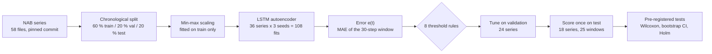

# Does Robust Adaptive Thresholding Help LSTM Autoencoder Anomaly Detection? A Leakage-Free Evaluation on NAB

**Zain Hassan** and **Muhammad Mateen Yaqoob**
Department of AI and Data Science, FAST-NUCES Islamabad.
Course project, DSTT (MS Data Science), November 2026.

LSTM autoencoders are often used to detect anomalies in cloud metrics, but
the rule that turns reconstruction error into an alarm gets little
attention. Our base paper (Ahmad 2026) raises an alarm when the error is
above the mean plus three standard deviations of the training errors. We
proposed a rolling median plus a multiple of the MAD instead, and compared
eight threshold rules on the errors of one shared LSTM autoencoder on the
Numenta Anomaly Benchmark (NAB), under a protocol where no test information
reaches training or tuning.

**Result: negative, and clear.** The base rule found 24 of the 25 test
anomalies but flagged 18.9 % of normal points. Rolling rules cut that to
1.8 % (RePAD2 rule) and 3.5 % (proposed rule). The proposed rule did not
beat the rolling mean rule and was significantly worse than the base rule on
composite F1 (0.544 vs 0.733, Wilcoxon p = 0.035). None of the
pre-registered hypotheses was supported. **For this model and benchmark,
making the threshold adaptive mattered; making it robust did not.**

## Start here

| If you want to... | Go to |
|---|---|
| Understand the whole project in plain words, with diagrams | [docs/REPORT.md](docs/REPORT.md) |
| Find a quick answer to a specific question | [docs/FAQ.md](docs/FAQ.md) |
| Read the paper | [paper/main.tex](paper/main.tex), Overleaf package [submission/DSTT_paper_latex.zip](submission/DSTT_paper_latex.zip) |
| See every figure | [figures/README.md](figures/README.md) |
| See the full result tables | [docs/phase3_thresholds.md](docs/phase3_thresholds.md) |
| Check that every number in the paper comes from a result file | [docs/paper_number_check.md](docs/paper_number_check.md) |
| See why each design choice was made, and when | [docs/decisions.md](docs/decisions.md) (D-01 to D-29) |
| See what was wrong in the earlier version and what changed | [docs/old_vs_new.md](docs/old_vs_new.md) |
| Rerun everything | [Reproduce](#reproduce) below |

## Pipeline

Every threshold rule gets exactly the same errors from exactly the same
trained model; only the rule that turns errors into alarms changes.

Data and split: each series is split in time order. The model learns from
the first 60 % without labels, rule parameters are chosen on the next 20 %,
and the last 20 % is scored once. Only 18 series have an anomaly in their
test part, so they form the evaluation set:

## Methods

All rules see the same errors e(t) and alarm when e(t) is above the
threshold.

| Method | Rule | Tuned on validation |
|---|---|---|
| Base (Ahmad 2026) | mean + 3 sd of training errors | nothing |
| B1 | p-th percentile of training errors | p |
| B2 | mean + k sd of training errors | k |
| S-robust | median + lambda * scaled MAD of training errors | lambda |
| R2 EVT (Yu et al. 2024) | generalized Pareto tail threshold of training errors (static part of their Alg. 2) | nothing |
| B3 RePAD2 rule (Lee & Lin 2023) | rolling mean + 3 sd of the previous w errors | w |
| B3-k | rolling mean + k sd of the previous w errors | k, w |
| P1 (proposed) | rolling median + lambda * scaled MAD of the previous w errors, plain or gated memory | lambda, w, memory |

B2 vs S-robust and B3-k vs P1 are the equal-budget comparisons of Gaussian
and robust statistics. Plain-language explanation:
[docs/REPORT.md, section 8](docs/REPORT.md#8-the-eight-threshold-rules).

## Results

Test parts of the 18 evaluation series; clean-stream false alarms on the 18
anomaly-free test parts. Mean ± sd over three seeds of the across-series
mean, from [results/phase3/test_summary.csv](results/phase3/test_summary.csv).

| Method | Selected | Composite F1 | Point F1 | Event recall | FPR | HV FPR | NAB first-step | Clean FA / 1000 |
|---|---|---|---|---|---|---|---|---|
| Base (Ahmad 2026) | - | 0.733 ± 0.011 | 0.355 ± 0.013 | 0.972 ± 0.000 | 0.189 ± 0.000 | 0.231 ± 0.001 | 72.0 ± 2.5 | 61.5 ± 1.9 |
| B1 percentile | p=90 | 0.587 ± 0.009 | 0.407 ± 0.013 | 0.972 ± 0.000 | 0.319 ± 0.006 | 0.488 ± 0.008 | 13.3 ± 6.8 | 187.3 ± 0.7 |
| B2 mean + k sd | k=2.5 | 0.718 ± 0.014 | 0.371 ± 0.017 | 0.972 ± 0.000 | 0.199 ± 0.000 | 0.250 ± 0.000 | 65.5 ± 2.9 | 81.1 ± 2.2 |
| S-robust median + lambda MAD | lambda=5 | 0.655 ± 0.018 | 0.332 ± 0.015 | 0.944 ± 0.000 | 0.215 ± 0.001 | 0.268 ± 0.002 | 44.6 ± 2.9 | 164.1 ± 3.3 |
| R2 EVT (Yu et al. 2024) | - | 0.639 ± 0.039 | 0.245 ± 0.007 | 0.806 ± 0.032 | 0.164 ± 0.001 | 0.171 ± 0.002 | 61.7 ± 2.1 | 17.1 ± 2.7 |
| B3 RePAD2 rule (Lee & Lin 2023) | w=400 | 0.743 ± 0.008 | 0.207 ± 0.010 | 0.917 ± 0.000 | 0.018 ± 0.000 | 0.070 ± 0.001 | 65.7 ± 1.7 | 24.5 ± 1.3 |
| B3-k rolling mean + k sd | k=3, w=400 | 0.743 ± 0.008 | 0.207 ± 0.010 | 0.917 ± 0.000 | 0.018 ± 0.000 | 0.070 ± 0.001 | 65.7 ± 1.7 | 24.5 ± 1.3 |
| P1 rolling median + lambda MAD (proposed) | lambda=6, memory=plain, w=50 | 0.544 ± 0.027 | 0.161 ± 0.002 | 0.769 ± 0.033 | 0.035 ± 0.002 | 0.080 ± 0.003 | 50.4 ± 4.7 | 68.2 ± 1.4 |

HV FPR: false-positive rate on high-variance normal points. ROC-AUC
(0.633) and PR-AUC (0.497) of the raw errors are the same for every rule.

### Hypotheses

Pre-registered in git before any threshold result existed
([D-26, D-28](docs/decisions.md)). Unit = series (mean over seeds), n = 18.

| Hypothesis | Verdict | Numbers |
|---|---|---|
| H1: P1 has higher composite F1 than Base | not supported; P1 significantly worse | difference -0.190 [95 % CI -0.351, -0.008], worse on 13 of 18 series, p = 0.035 |
| H2: P1 has lower high-variance FPR than Base | not supported | lower on average (-0.151) but p = 0.109 (n = 17) |
| NAB score (every step): P1 vs Base | no significant difference | p = 0.832 |
| Proposal H1: higher point F1 on at least 70 % of series | not supported | P1 higher on 3 of 18 vs Base, 5 of 18 vs B3 |
| Proposal H2: at least 15 % lower high-variance FPR | not supported | criterion met vs Base, but neither test significant |
| Proposal H3: AWS CloudWatch gains most | partly, descriptively, only vs Base | [category_analysis.csv](results/phase3/category_analysis.csv) |

Sources: [hypothesis_tests.csv](results/phase3/hypothesis_tests.csv),
[proposal_hypotheses.csv](results/phase3/proposal_hypotheses.csv).

### Why P1 lost

The base rule's threshold is too **low** on later data (median test error is
1.20 times the median training error, larger in 17 of 18 series), so any
rule that follows recent errors removes most false alarms. P1, with its
short window (w = 50), then suffers the masking it was meant to prevent: the
median and MAD rise with the anomaly. In the last anomaly window of
`nyc_taxi`, 1 error exceeds P1's threshold, against 30 for B3 and 73 for
Base:

All figures, with what each shows: [figures/README.md](figures/README.md).

## The paper

| | |
|---|---|
| Source | [paper/main.tex](paper/main.tex), [paper/refs.bib](paper/refs.bib) (12 references, all 2021 or later, each with a DOI or link: [docs/references.md](docs/references.md)) |
| Tables | generated from the CSV files by [scripts/make_paper_tables.py](scripts/make_paper_tables.py) into [paper/tables/](paper/tables) |
| Figures | print-size PDFs in [paper/figures/](paper/figures), written by [scripts/make_paper_figures.py](scripts/make_paper_figures.py) |
| Overleaf | upload [submission/DSTT_paper_latex.zip](submission/DSTT_paper_latex.zip) as a new project and compile with pdfLaTeX |

## Reproduce

Windows with Git Bash, Python 3.12 (via the `py` launcher). Run times were
measured on the machine in [docs/hardware.md](docs/hardware.md) (Intel Core
i5-13500H, 15.7 GB RAM, CPU only).

| Step | Command | Time |
|---|---|---|
| Environment (PyTorch CPU, pinned) | `bash scripts/setup_env.sh` | 4.4 min |
| NAB data at commit ea702d75 | `bash scripts/fetch_nab.sh` | 17 s |
| Unit tests (45) | `envs/pipeline/Scripts/python.exe -m pytest` | 5 to 10 s |
| Scorer check against NAB results | `envs/pipeline/Scripts/python.exe scripts/validate_scorer.py` | 30 s |
| EDA tables and figures | `envs/pipeline/Scripts/python.exe scripts/eda.py` | 6 s |
| File selection | `envs/pipeline/Scripts/python.exe scripts/make_selection.py` | 1 s |
| LSTM-AE training, 36 series x 3 seeds (resumable) | `envs/pipeline/Scripts/python.exe scripts/train.py` | 47.5 min |
| Threshold tuning and single test scoring | `envs/pipeline/Scripts/python.exe scripts/phase3.py` | 2.4 min |
| Exploratory grid extension (post hoc) | `envs/pipeline/Scripts/python.exe scripts/phase3.py --grids exploratory` | 4.0 min |
| Pre-registered tests | `envs/pipeline/Scripts/python.exe scripts/hypothesis_tests.py` | 1.5 s |
| Proposal hypotheses, categories, delay | `envs/pipeline/Scripts/python.exe scripts/proposal_hypotheses.py` | 1.6 s |
| Error drift (test / train median error) | `envs/pipeline/Scripts/python.exe scripts/error_drift.py` | 0.9 s |
| Figures | `scripts/plot_phase2.py`, `plot_phase3.py`, `plot_phase3_results.py`, `plot_proposal.py` | seconds each (not timed separately) |
| Paper figures and their PNG previews | `envs/pipeline/Scripts/python.exe scripts/make_paper_figures.py --png-dir figures/paper` | seconds |
| Paper tables | `envs/pipeline/Scripts/python.exe scripts/make_paper_tables.py` | 0.7 s |
| Paper number check | `envs/pipeline/Scripts/python.exe scripts/check_paper_numbers.py` | 1.7 s |

Training is deterministic for a given seed on CPU. The error series of all
108 fits are saved in `results/phase2_errors/`, so every later step can be
rerun without training.

## Repository layout

    pipeline/    data loading and splits, LSTM-AE, threshold rules, metrics, NAB scorer, plotting
    scripts/     every step above
    configs/     file selection (datasets.json)
    results/     CSV/JSON/NPZ outputs per phase
    figures/     every figure (PNG 300 dpi + PDF), with an index in figures/README.md
    paper/       LaTeX source, print-size figures and generated tables
    submission/  LaTeX package for Overleaf
    docs/        report, FAQ, decisions, edit log, phase reports, hardware, environment
    logs/        training log
    tests/       unit tests
    references/  placeholder for external reference implementations

## Documentation

- [docs/REPORT.md](docs/REPORT.md): the whole pipeline in plain words, with diagrams
- [docs/FAQ.md](docs/FAQ.md): questions and answers with links to the evidence
- [docs/decisions.md](docs/decisions.md): every design decision (D-01 to D-29), with who decided and why
- [docs/edit_log.md](docs/edit_log.md): dated log of changes
- [docs/old_vs_new.md](docs/old_vs_new.md): audit of the earlier project and what changed
- [docs/phase1_eda.md](docs/phase1_eda.md), [docs/phase2_model.md](docs/phase2_model.md), [docs/phase3_thresholds.md](docs/phase3_thresholds.md): phase reports
- [docs/paper_number_check.md](docs/paper_number_check.md): every number in the paper with its source file
- [docs/references.md](docs/references.md): the paper's references with links

## Citation

    Z. Hassan and M. M. Yaqoob, "Does Robust Adaptive Thresholding Help LSTM
    Autoencoder Anomaly Detection? A Leakage-Free Evaluation on NAB,"
    course project paper, FAST-NUCES Islamabad, 2026.
    Code: https://github.com/zain0254/DSTT-Anomaly-Detection-

## License

MIT (this repository). NAB data and scorer: MIT, Numenta.
