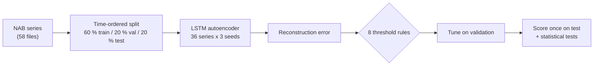

# Does Robust Adaptive Thresholding Help LSTM Autoencoder Anomaly Detection? A Leakage-Free Evaluation on NAB

**Zain Hassan**, Department of AI and Data Science, FAST-NUCES Islamabad.
DSTT semester project (MS Data Science), November 2026. Course instructor:
Muhammad Mateen Yaqoob.

## What this project does

An LSTM autoencoder learns to rebuild normal stretches of a time series. A
window it rebuilds badly has a large **reconstruction error**, and an alarm
is raised when that error crosses a **threshold**. Our base paper
(Ahmad 2026) uses a fixed threshold: mean + 3 standard deviations of the
training errors. We proposed a **rolling median + MAD** threshold instead,
expecting it to resist outliers and follow changes in the data.

We tested this on the Numenta Anomaly Benchmark (NAB). One shared LSTM
autoencoder produces the errors, and eight threshold rules turn them into
alarms. No test information reaches training or tuning.

## Main result

**Negative, and clear.** Making the threshold *adaptive* mattered; making it
*robust* did not.

| Rule | Composite F1 | Event recall | False-positive rate |
|---|---|---|---|
| Base: static mean + 3 sd (Ahmad 2026) | 0.733 | 0.972 | 0.189 |
| B3: rolling mean + 3 sd (RePAD2 rule) | **0.743** | 0.917 | **0.018** |
| P1: rolling median + MAD (proposed) | 0.544 | 0.769 | 0.035 |

The base rule found 24 of the 25 test anomalies but flagged 18.9 % of normal
points. Both rolling rules removed most false alarms. The proposed rule was
significantly worse than the base rule on composite F1 (Wilcoxon p = 0.035),
and none of the hypotheses fixed in advance was supported. All eight rules,
with standard deviations and NAB scores, are in
[REPORT.md, section 11](REPORT.md#11-results).

## How it works



The model learns from the first 60 % of each series without labels. Each
rule's parameters are chosen on the next 20 %, and the last 20 % is scored
once. Every rule sees exactly the same errors, so only the threshold rule
differs.

## Where to find things

| I want to... | Go to |
|---|---|
| Understand the whole project in plain words, with diagrams | [REPORT.md](REPORT.md) |
| Read the paper | [paper/main.tex](paper/main.tex); Overleaf package: [submission/DSTT_paper_latex.zip](submission/DSTT_paper_latex.zip) |
| See all figures and what each one shows | [figures/README.md](figures/README.md) |
| Check the result files behind every number | [results/](results), especially [results/phase3/test_summary.csv](results/phase3/test_summary.csv) |
| Check that every number in the paper matches the results | [paper/number_check.md](paper/number_check.md) |
| Read the code | [pipeline/](pipeline) (library) and [scripts/](scripts) (one script per step) |
| Rerun everything | [Reproduce](#reproduce) below |

## Repository layout

```text
.
├── README.md          this page
├── REPORT.md          the full pipeline explained step by step
├── pipeline/          reusable code: data and splits, LSTM-AE, threshold rules, metrics, NAB scorer
├── scripts/           one script per step (fetch data, train, tune, test, figures, paper tables)
├── configs/           which NAB series are used for tuning and evaluation
├── tests/             45 unit tests
├── results/           every output: CSV tables, error series, training log, run environment
│   ├── phase1_eda/          data exploration tables
│   ├── phase2_errors/       reconstruction errors of all 108 trained models
│   ├── phase3/              tuning, test results and hypothesis tests (primary)
│   ├── phase3_exploratory/  post-hoc grid extension (clearly separate)
│   └── environment/         hardware, package versions, run times
├── figures/           all figures (PNG + PDF), indexed in figures/README.md
├── paper/             LaTeX source, print-size figures, generated tables, number check
└── submission/        the zipped LaTeX package for Overleaf
```

The NAB data is downloaded by `scripts/fetch_nab.sh` into `data/` and is not
stored in git.

## Reproduce

Windows with Git Bash and Python 3.12. Times are from the laptop in
[results/environment/](results/environment) (Intel Core i5-13500H, CPU
only). After the first step, activate the environment with
`source envs/pipeline/Scripts/activate`, so that `python` below is the
pinned one.

| Step | Command | Time |
|---|---|---|
| Environment (pinned, PyTorch CPU) | `bash scripts/setup_env.sh` | 4.4 min |
| NAB data at commit ea702d75 | `bash scripts/fetch_nab.sh` | 17 s |
| Unit tests | `python -m pytest` | 5 to 10 s |
| Scorer check against NAB's own results | `python scripts/validate_scorer.py` | 30 s |
| Data exploration | `python scripts/eda.py` | 6 s |
| Series selection | `python scripts/make_selection.py` | 1 s |
| Train 36 series x 3 seeds (resumable) | `python scripts/train.py` | 47.5 min |
| Tune thresholds, score test once | `python scripts/phase3.py` | 2.4 min |
| Exploratory grid extension | `python scripts/phase3.py --grids exploratory` | 4.0 min |
| Hypothesis tests | `python scripts/hypothesis_tests.py` and `python scripts/proposal_hypotheses.py` | seconds |
| Error drift | `python scripts/error_drift.py` | 1 s |
| Figures | `python scripts/plot_phase2.py`, `plot_phase3.py`, `plot_phase3_results.py`, `plot_proposal.py` | seconds |
| Paper figures, tables, number check | `python scripts/make_paper_figures.py --png-dir figures/paper`, `python scripts/make_paper_tables.py`, `python scripts/check_paper_numbers.py` | seconds |

Training is deterministic for a given seed on CPU. The errors of all 108
models are saved in `results/phase2_errors/`, so every later step can be
rerun without training.

## Citation

    Z. Hassan, "Does Robust Adaptive Thresholding Help LSTM Autoencoder
    Anomaly Detection? A Leakage-Free Evaluation on NAB," DSTT semester
    project paper, FAST-NUCES Islamabad, 2026.
    Code: https://github.com/zain0254/DSTT-Anomaly-Detection-

## License

MIT for this repository. NAB data and scorer: MIT, Numenta.
