# Project report: the whole pipeline in plain words

**Does Robust Adaptive Thresholding Help LSTM Autoencoder Anomaly Detection?
A Leakage-Free Evaluation on NAB**
Zain Hassan, FAST-NUCES Islamabad. DSTT semester project, MS Data Science,
November 2026. Course instructor: Muhammad Mateen Yaqoob.

This report explains every step of the project without assuming you have
read the paper. Each section says what we did, why, and where the evidence
is in this repository. Every number is copied from a file in `results/`.
The numbers in the paper are checked by a script against the same files
([paper/number_check.md](paper/number_check.md)).

Contents

1. [The question and the short answer](#1-the-question-and-the-short-answer)
2. [The pipeline at a glance](#2-the-pipeline-at-a-glance)
3. [The data](#3-the-data)
4. [Splitting each series in time](#4-splitting-each-series-in-time)
5. [Which series are used for what](#5-which-series-are-used-for-what)
6. [The model](#6-the-model)
7. [From model output to an anomaly score](#7-from-model-output-to-an-anomaly-score)
8. [The eight threshold rules](#8-the-eight-threshold-rules)
9. [Choosing parameters without touching the test data](#9-choosing-parameters-without-touching-the-test-data)
10. [How we measure success](#10-how-we-measure-success)
11. [Results](#11-results)
12. [Hypothesis tests](#12-hypothesis-tests)
13. [Why the proposed rule lost](#13-why-the-proposed-rule-lost)
14. [Keeping the study honest](#14-keeping-the-study-honest)
15. [What changed from the earlier pilot](#15-what-changed-from-the-earlier-pilot)
16. [Limitations](#16-limitations)
17. [Common questions](#17-common-questions)
18. [Design decisions D-01 to D-29](#18-design-decisions-d-01-to-d-29)
19. [Glossary](#19-glossary)

---

## 1. The question and the short answer

An LSTM autoencoder learns what "normal" looks like in a time series. When
it cannot rebuild a piece of the series well, that piece is unusual. The
size of the rebuilding mistake is the **reconstruction error**. To raise an
alarm, the error has to cross a **threshold**.

Our base paper (Ahmad 2026) uses a fixed threshold: the mean of the training
errors plus three standard deviations (mean + 3 sd). Our proposal argued
that this has two problems:

- a few big errors pull the mean and sd up, so the threshold may be too high
  and hide anomalies (this is called **masking**);
- a fixed threshold cannot follow a series whose behaviour changes over time.

So we proposed **P1**: a threshold recomputed at every step from the last
`w` errors, using the median and the MAD (median absolute deviation) instead
of the mean and sd. The median and MAD barely move when a few values are
extreme, which is why they are called robust.

**Question:** does this robust, adaptive threshold detect anomalies better
than the base paper's rule and other common rules?

**Short answer: no.** Making the threshold *adaptive* (rolling) helped a lot.
Making it *robust* (median and MAD) did not. The rolling mean + 3 sd rule of
RePAD2 did best overall, and P1 was significantly worse than the base rule
on the main measure.

## 2. The pipeline at a glance

Every threshold rule receives exactly the same errors from exactly the same
trained models. The only thing that changes between methods is the rule that
turns errors into alarms, so the comparison is fair.

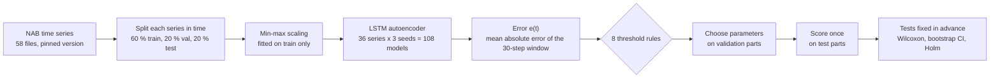

The same pipeline as drawn in the paper (Fig. 2):

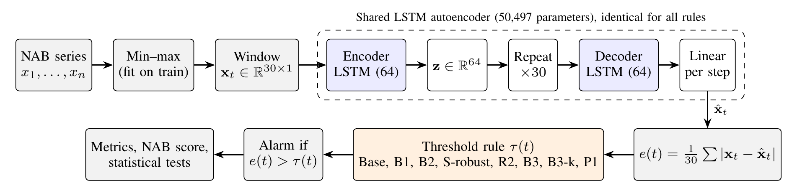

| Step | Script | Output |
|---|---|---|
| Get NAB at a fixed commit | [scripts/fetch_nab.sh](scripts/fetch_nab.sh) | `data/nab/` (not in git) |
| Check our NAB scorer against NAB's own results | [scripts/validate_scorer.py](scripts/validate_scorer.py) | [results/scorer_validation.csv](results/scorer_validation.csv) |
| Explore the data | [scripts/eda.py](scripts/eda.py) | [results/phase1_eda/](results/phase1_eda), [figures/phase1_eda/](figures/phase1_eda) |
| Pick the series | [scripts/make_selection.py](scripts/make_selection.py) | [configs/datasets.json](configs/datasets.json) |
| Train the models | [scripts/train.py](scripts/train.py) | [results/phase2_errors/](results/phase2_errors) |
| Tune and test the threshold rules | [scripts/phase3.py](scripts/phase3.py) | [results/phase3/](results/phase3) |
| Hypothesis tests | [scripts/hypothesis_tests.py](scripts/hypothesis_tests.py), [scripts/proposal_hypotheses.py](scripts/proposal_hypotheses.py) | `results/phase3/*hypothes*.csv` |
| Figures and paper tables | `scripts/plot_*.py`, [scripts/make_paper_figures.py](scripts/make_paper_figures.py), [scripts/make_paper_tables.py](scripts/make_paper_tables.py) | [figures/](figures), [paper/](paper) |

The reusable code (data loading, model, threshold rules, metrics, NAB
scorer) is in [pipeline/](pipeline), with 45 unit tests in [tests/](tests).

## 3. The data

We use the **Numenta Anomaly Benchmark (NAB)**, a public set of real and
artificial time series with labelled anomaly windows. The version is pinned
to git commit `ea702d75`, so anyone gets the same files (D-02).

| | Value |
|---|---|
| Series (files) | 58 in 7 categories |
| Data points | 365,558 |
| Labelled anomaly windows | 116 |
| Share of points inside windows | 9.16 % |
| Series with at least one window | 52 |

Source: [results/phase1_eda/category_summary.csv](results/phase1_eda/category_summary.csv).

One example per category (shaded = anomaly window, dashed = our split
boundaries):

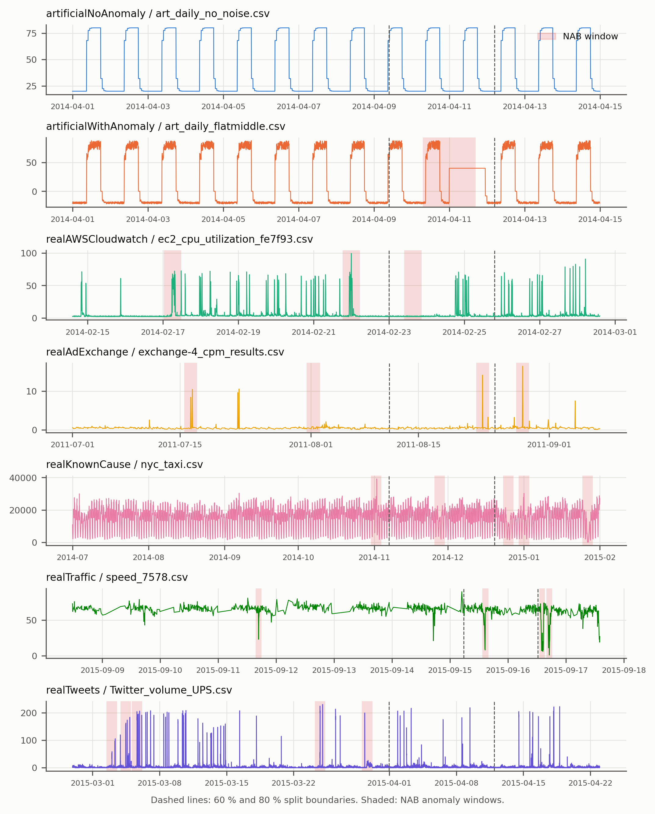

What the data check found, and what we did about it:

- No missing values, but 49 duplicate timestamps in 8 files. We keep them,
  because NAB's own scorer scores every row (D-19).
- 25 files have irregular time steps. We do not fill the gaps, because NAB
  labels and scores rows, not clock times (D-20).
- Some files are dominated by a few spikes, so most errors are small and a
  few are very large. This is exactly where mean/sd and median/MAD differ
  most, so NAB is a fair test for our idea.

## 4. Splitting each series in time

Each series is cut into three parts **in time order**, never shuffled:

```text
|<----------------- train 60 % ----------------->|<-- val 20 % -->|<-- test 20 % -->|
  model learns here (no labels used)               tune thresholds   score once
```

- **Train (first 60 %)**: the model learns from it. Labels are not used.
- **Validation (next 20 %)**: used only to choose each rule's parameters.
- **Test (last 20 %)**: used once, at the end, to report results.

Time order matters because a real monitor only ever sees the past.

**Why train without labels?** A deployed detector does not know where the
anomalies in its history are, and the base paper fits its threshold on all
training errors. The earlier pilot of this project removed labelled windows
from training, which quietly gave the static rules information a real system
would not have (D-04, [section 15](#15-what-changed-from-the-earlier-pilot)).

## 5. Which series are used for what

Of the 116 windows, only 25 fall in the test part, and they sit in 18
series. Those 18 series are therefore the only ones that can be scored.

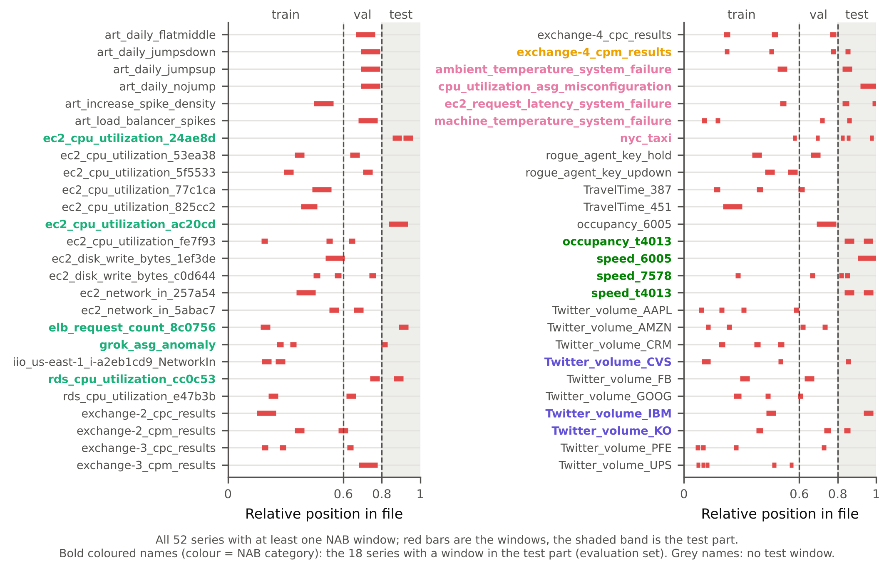

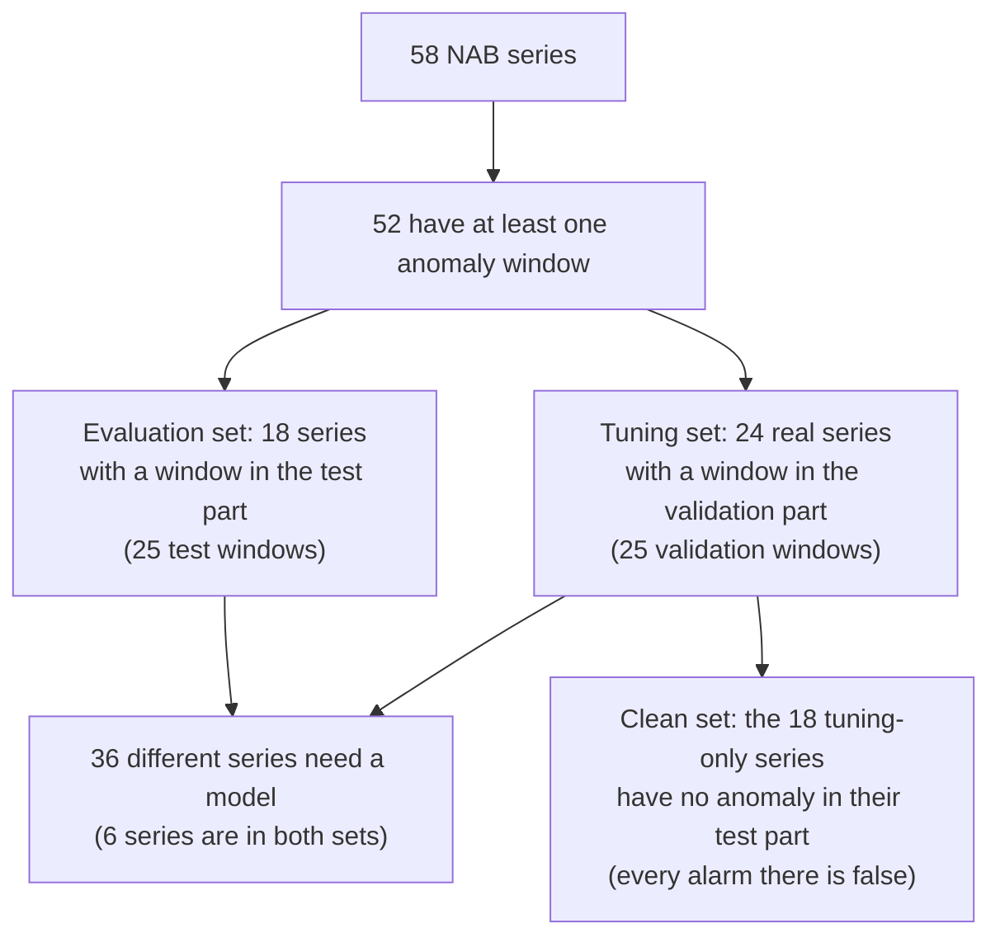

- The 6 series in both sets are safe: their validation and test parts do not
  overlap in time, and every rule only looks backwards.
- Artificial series are left out of tuning, so that tuning matches the
  all-real evaluation set.
- `grok_asg_anomaly` is left out of tuning because one of its windows starts
  in validation and ends in test.

The exact lists are in [configs/datasets.json](configs/datasets.json),
generated by [scripts/make_selection.py](scripts/make_selection.py) (D-21).

## 6. The model

The model follows the base paper, except that we use PyTorch instead of
Keras. TensorFlow has no native Windows GPU support after version 2.10, and
the architecture is unchanged (D-11).

| Part | Setting |
|---|---|
| Input | window of 30 steps, 1 value per step |
| Encoder | LSTM with 64 units, keep the last hidden state |
| Bottleneck | that 64-number summary, repeated 30 times |
| Decoder | LSTM with 64 units |
| Output | one linear layer per step, rebuilding the 30 values |
| Size | 50,497 trainable parameters |
| Training | Adam, learning rate 0.001, batch size 32, mean squared error loss |
| Stopping | at most 50 epochs; stop after 5 epochs without improvement on the last 10 % of the training part |
| Repeats | every series trained with 3 seeds (15, 42, 123) |

The base paper does not give batch size, learning rate or patience, so we
used the Keras defaults (D-23). Each of the 36 series was trained 3 times:
**108 models, 0 failures, 47.5 minutes on a laptop CPU**. Epochs run ranged
from 6 to 50 (median 20). Training log:
[results/phase2_train.log](results/phase2_train.log); machine and times:
[results/environment/](results/environment).

Training curves for four series:

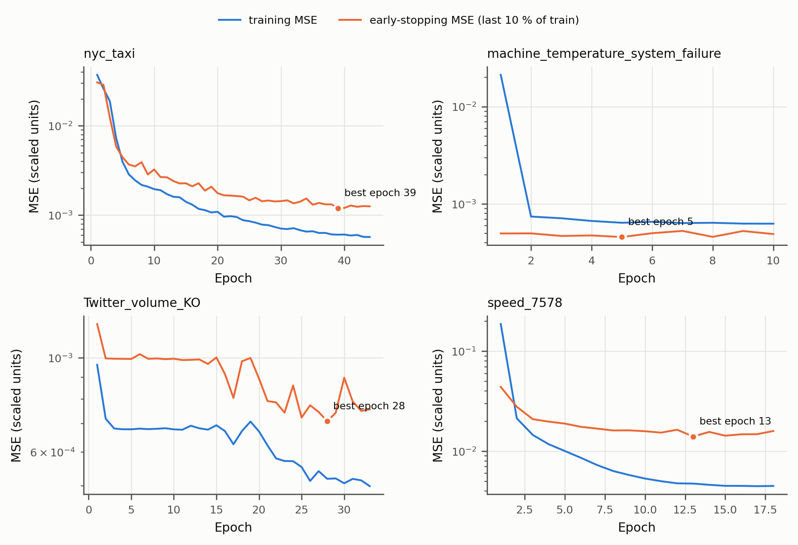

All 108 error series are saved in `results/phase2_errors/`, so every later
step can be rerun without retraining.

## 7. From model output to an anomaly score

For the window that ends at time `t`, the score is the mean absolute
difference between the real 30 values and the rebuilt 30 values:

```text
e(t) = (1/30) * sum over the window of |real value - rebuilt value|
```

The score belongs to the **last** time step of the window, so it only uses
data up to `t` (D-13). The first 29 points of each series have no score.

Example: the `nyc_taxi` series and its error. The error rises inside the
shaded anomaly windows, but also at other times, which is why the choice of
threshold matters.

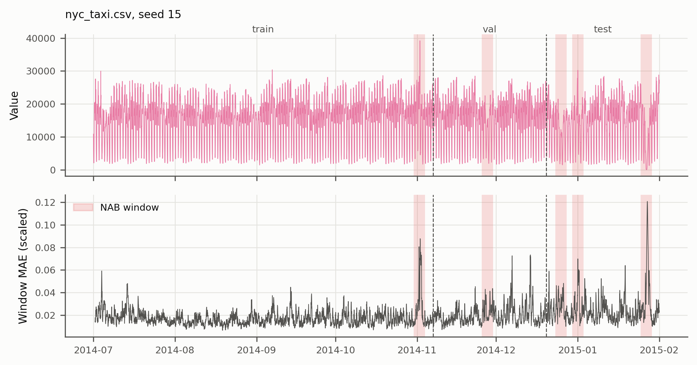

## 8. The eight threshold rules

All rules raise an alarm when `e(t)` is strictly above the threshold (D-15).

**Static rules** compute one number from the training errors and keep it:

| Rule | Threshold | Parameter chosen on validation |
|---|---|---|
| **Base** (Ahmad 2026, the base paper) | mean + 3 sd of training errors | none (3 is fixed by the paper) |
| **B1** | p-th percentile of training errors | p |
| **B2** | mean + k sd of training errors | k |
| **S-robust** | median + lambda x scaled MAD of training errors | lambda |
| **R2** (Yu et al. 2024) | extreme value theory: a tail curve fitted to the largest training errors | none (set from training errors only) |

**Rolling rules** recompute the threshold at every step from the last `w`
errors, so they follow the series as it changes:

| Rule | Threshold at time t | Parameters chosen on validation |
|---|---|---|
| **B3** (RePAD2 rule, Lee & Lin 2023) | mean + 3 sd of the previous w errors | w |
| **B3-k** | mean + k sd of the previous w errors | k, w |
| **P1** (our proposal) | median + lambda x scaled MAD of the previous w errors | lambda, w, memory |

How a rolling rule works, step by step:

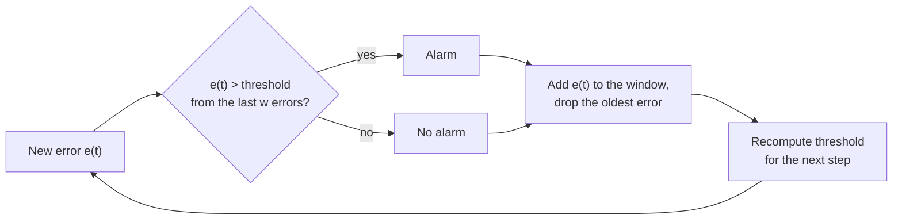

P1 has a second option called **gated memory**: errors that raise an alarm
are kept out of the window, so an anomaly cannot pull the threshold up. If
an alarm run lasts longer than `w` steps, the new level is accepted as
normal (D-08). The paper's Algorithm 1 gives the exact steps; the code is
`rolling_alarms` in [pipeline/thresholds.py](pipeline/thresholds.py).

**Fair comparisons built in.** B2 and S-robust differ only in mean/sd versus
median/MAD (both static, one parameter). B3-k and P1 differ in the same way
(both rolling, same parameters tuned). If robust statistics help, these
pairs should show it.

Two safety details, fixed before any result existed (D-09):

- MAD is multiplied by 1.4826 so it is on the same scale as an sd.
- Rolling rules never let their spread fall below 0.1 x the scaled MAD of
  the training errors, so a perfectly flat stretch does not turn every tiny
  bump into an alarm.

How the two published rules were adapted (D-24): RePAD2's own windows
(1,440 to 16,128 steps) are longer than many NAB series, so its window is
tuned like the other rolling rules. Yu et al.'s dynamic update (their Eq. 9)
is not fully specified, so only the fully specified static part was
reproduced. Both are applied to our model's errors, so only the rule differs.

## 9. Choosing parameters without touching the test data

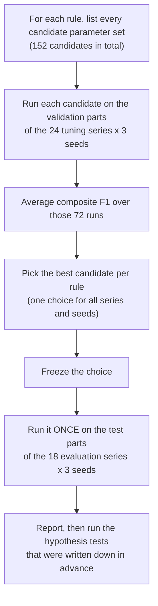

What was selected ([results/phase3/selected_params.csv](results/phase3/selected_params.csv)):

| Rule | Selected |
|---|---|
| B1 | p = 90 |
| B2 | k = 2.5 |
| S-robust | lambda = 5 |
| B3 | w = 400 |
| B3-k | k = 3, w = 400 (the same as B3) |
| P1 | lambda = 6, w = 50, plain memory |

How the validation score changes with each parameter:

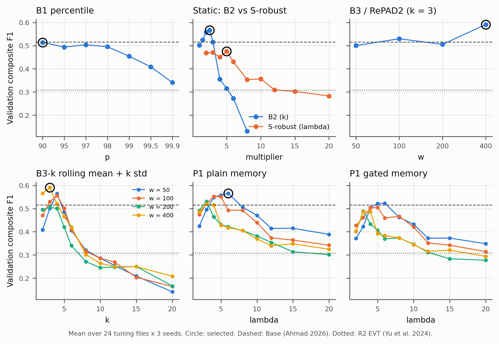

Tuning and test scoring took 135 s and 6 s
([results/environment/run_times.md](results/environment/run_times.md)).

## 10. How we measure success

| Measure | In plain words | Better |
|---|---|---|
| **Composite F1** (main measure) | combines "how many alarms were real" (precision) with "how many anomaly windows were caught at least once" (event recall) | higher |
| Point F1 | precision and recall counted point by point, without the "point adjustment" trick that inflates scores | higher |
| Event recall | share of anomaly windows with at least one alarm | higher |
| FPR | share of normal points that raised an alarm | lower |
| High-variance FPR | FPR only on the noisy stretches, where our proposal expected the biggest gain | lower |
| Clean-stream false alarms | alarms per 1,000 points on test parts with no anomaly at all | lower |
| NAB score | NAB's official scoring, which rewards early detection and penalises false alarms | higher |
| Detection delay | how far into a window the first alarm comes (0 = start, 1 = end) | lower |

Why no point adjustment: it counts a whole window as detected if a single
point is flagged, which makes even random alarms look good (Kim et al.
2022).

Our NAB scorer is a port of NAB's official code. On the full files with
NAB's settings it reproduces NAB's published results for three detectors
and three scoring profiles to within 5e-12
([results/scorer_validation.csv](results/scorer_validation.csv)). Our NAB
scores use the test parts and no probationary period, so they are not
comparable to the NAB leaderboard (D-07).

Statistics: the unit is one series (the metric averaged over the 3 seeds),
so n = 18. We use the paired Wilcoxon signed-rank test, a bootstrap 95 %
confidence interval for the mean difference, and the Holm correction when
P1 is compared with several rules at once.

## 11. Results

Test parts of the 18 evaluation series; clean-stream false alarms on the 18
anomaly-free test parts. Mean ± sd over three seeds of the across-series
mean ([results/phase3/test_summary.csv](results/phase3/test_summary.csv)).
Best value per column in bold.

| Rule | Composite F1 | Point F1 | Event recall | FPR | High-var. FPR | NAB every-step | NAB first-step | Clean FA / 1000 |
|---|---|---|---|---|---|---|---|---|
| Base (base paper) | 0.733 ± 0.011 | 0.355 ± 0.013 | **0.972** | 0.189 | 0.231 | −370.2 | **72.0** | 61.5 |
| B1 percentile | 0.587 ± 0.009 | **0.407 ± 0.013** | **0.972** | 0.319 | 0.488 | −1026.9 | 13.3 | 187.3 |
| B2 mean + k sd | 0.718 ± 0.014 | 0.371 ± 0.017 | **0.972** | 0.199 | 0.250 | −413.3 | 65.5 | 81.1 |
| S-robust | 0.655 ± 0.018 | 0.332 ± 0.015 | 0.944 | 0.215 | 0.268 | −540.2 | 44.6 | 164.1 |
| R2 EVT | 0.639 ± 0.039 | 0.245 ± 0.007 | 0.806 | 0.164 | 0.171 | −284.8 | 61.7 | **17.1** |
| B3 rolling mean (RePAD2) | **0.743 ± 0.008** | 0.207 ± 0.010 | 0.917 | **0.018** | **0.070** | **−28.7** | 65.7 | 24.5 |
| B3-k | **0.743 ± 0.008** | 0.207 ± 0.010 | 0.917 | **0.018** | **0.070** | **−28.7** | 65.7 | 24.5 |
| **P1 (proposed)** | 0.544 ± 0.027 | 0.161 ± 0.002 | 0.769 | 0.035 | 0.080 | −113.6 | 50.4 | 68.2 |

NAB columns are corpus scores (standard profile). ROC-AUC (0.633) and PR-AUC
(0.497) of the raw errors are the same for every rule, because they do not
depend on the threshold.

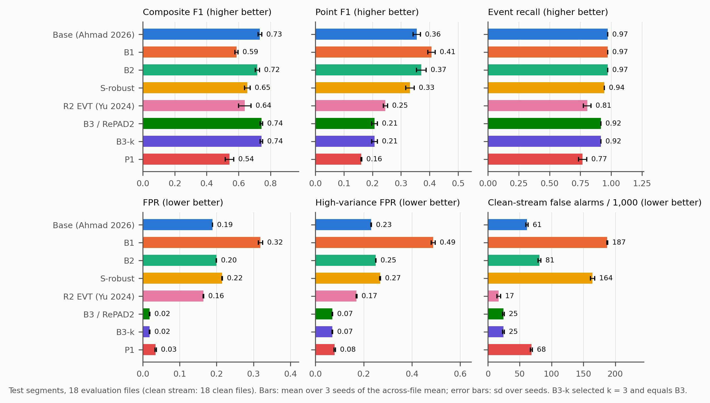

What the table says:

1. **The base rule finds almost everything but cries wolf.** It caught 24 of
   the 25 test windows, but 18.9 % of normal points raised an alarm.
2. **Rolling rules fix the false alarms.** B3 cut FPR to 1.8 % (about a
   tenth of Base) and P1 to 3.5 % (about a fifth), and B3 kept the best
   composite F1 of all rules.
3. **The robust version did not beat the plain version.** P1 lost to B3 on
   composite F1, event recall and clean-stream false alarms. In the static
   pair, S-robust also had a lower composite F1 than B2.
4. **Point F1 ranks the rules differently.** It rewards flagging many points
   inside the long NAB windows, so rules that alarm a lot (B1, B2, Base)
   score well on it despite many false alarms.

Missed windows and delay
([results/phase3/detection_delay.csv](results/phase3/detection_delay.csv)),
out of 25 test windows, mean over seeds:

| Rule | Missed windows | Mean delay of detected windows |
|---|---|---|
| Base, B1, B2, S-robust | 1 each | 0.20 (B1) to 0.42 (Base) |
| B3, B3-k | 3 | 0.43 |
| R2 | 5.3 | 0.45 |
| P1 | 6.7 ± 1.5 | 0.41 |

Delays cover different sets of windows, so read them together with the
missed counts.

**Exploratory run (after the results, clearly labelled).** Four selections
sat at the edge of their grid (B1 p = 90, B3 and B3-k w = 400, P1 w = 50).
We noticed this only after the test results were known, so we extended
those grids in a separate run (D-27, [results/phase3_exploratory/](results/phase3_exploratory)).
P1 and B1 kept their choices. B3 moved to w = 600, which lowered its test
composite F1 to 0.713, raised point F1 to 0.240 and improved the every-step
NAB score from −28.7 to −16.8. This run does not replace any primary result.

## 12. Hypothesis tests

Two sets of hypotheses were fixed before the results, in two different
ways:

- **D-26 (our confirmatory tests)** was committed to git at 03:10 on
  18 November 2026, in commit
  [f3c12c6](https://github.com/zain0254/DSTT-Anomaly-Detection-/commit/f3c12c6f8e24dd68a51fa657f075d7cf9503d837).
  The first threshold results were committed at 03:16, in
  [d5d790b](https://github.com/zain0254/DSTT-Anomaly-Detection-/commit/d5d790b17286ae14836a160799aaa0c269c23f1e).
- **The proposal hypotheses (D-28)** come from the project proposal defended
  in October 2026, before any experiment. They were written into git later,
  at 03:47 in
  [ee1bde9](https://github.com/zain0254/DSTT-Anomaly-Detection-/commit/ee1bde9f60ca40f4b2192c28adbf79397fddbc77),
  after the D-26 results. They are tested exactly as stated in the proposal.

D-26 as registered: measures H1 composite F1, H2 high-variance FPR
(secondary: clean-stream FPR and false alarms per 1,000 points), and the
every-step NAB score. Primary comparison P1 vs Base. Secondary comparisons
P1 vs every other rule, Holm-corrected. Unit = series, n = 18; paired
two-sided Wilcoxon test, mean difference with bootstrap 95 % CI,
wins/ties/losses; alpha = 0.05.

| Hypothesis | Result | Evidence |
|---|---|---|
| H1: P1 has higher composite F1 than Base | **Not supported.** P1 was significantly **worse**: difference −0.190, 95 % CI −0.351 to −0.008, worse on 13 of 18 series, p = 0.035 | [hypothesis_tests.csv](results/phase3/hypothesis_tests.csv) |
| H2: P1 has lower high-variance FPR than Base | **Not supported.** Lower on average (−0.151) but not significant, p = 0.109 (n = 17) | same file |
| NAB every-step score: P1 vs Base | No significant difference, p = 0.832 | same file |
| Proposal H1: P1 has higher point F1 on at least 70 % of series | **Not supported**: higher on 3 of 18 vs Base, 5 of 18 vs B3 | [proposal_hypotheses.csv](results/phase3/proposal_hypotheses.csv) |
| Proposal H2: P1 cuts high-variance FPR by at least 15 % | **Not supported**: the 15 % was met against Base, but neither test was significant | same file |
| Proposal H3: AWS CloudWatch series gain most | **Partly**, descriptively, and only against Base | [category_analysis.csv](results/phase3/category_analysis.csv) |

High-variance FPR has n = 17 because one series has no normal test point in
its noisy stretches.

Per-series view (each dot is one series; the paper's Fig. 3):

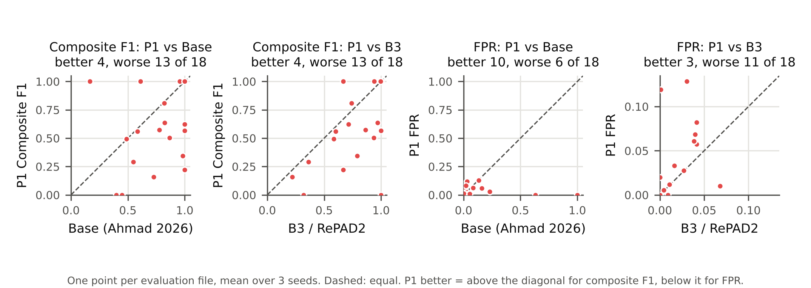

Per category (the paper's Fig. 4). Categories have only 1 to 5 series, so
this is descriptive:

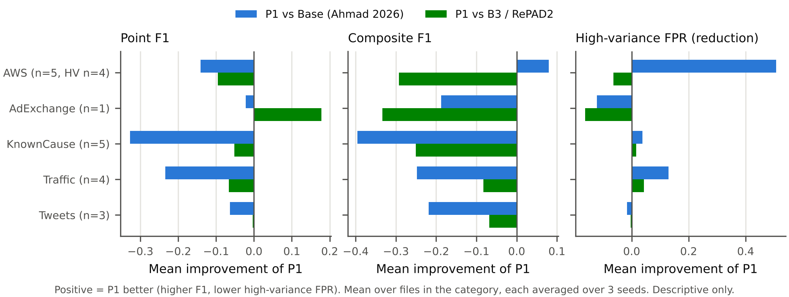

## 13. Why the proposed rule lost

**The base rule's problem was the opposite of what we expected.** We
expected mean + 3 sd to be too high and miss anomalies. In fact it was too
low on later data: the median test error was 1.20 times the median training
error, and test errors were larger in 17 of the 18 series
([error_drift.csv](results/phase3/error_drift.csv)). A threshold fitted on
training errors therefore fires too often. Any rule that follows recent
errors fixes this, robust or not.

**Masking moved into P1 itself.** P1 chose a short window (`w = 50`). In 50
steps an anomaly quickly fills a large share of the window, and then the
median and MAD rise just as a mean would. The threshold climbs with the
anomaly, and the anomaly hides under it. The figure below (the paper's
Fig. 5) shows this on `nyc_taxi`, seed 15: in the last anomaly window, only
1 error is above P1's threshold, against 30 for B3 and 73 for Base.

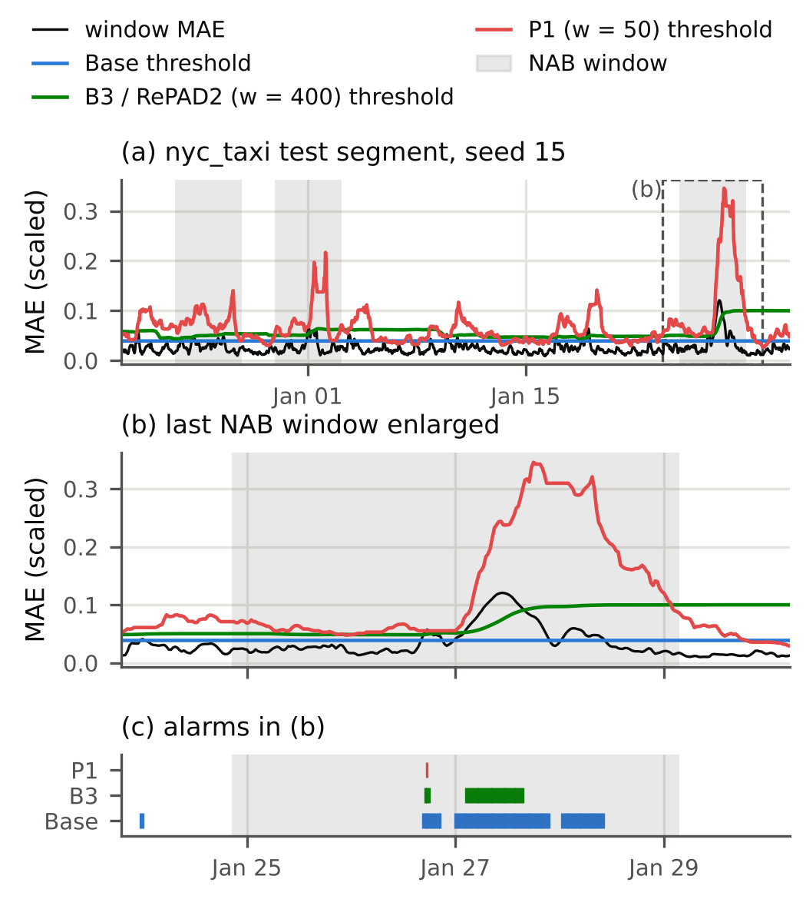

This example was not picked to make the point: `nyc_taxi` with seed 15 was
fixed as the Phase 2 example in commit
[baccb8c](https://github.com/zain0254/DSTT-Anomaly-Detection-/commit/baccb8c3f6435ab0098862a8f8dd9133da69f195),
before any threshold was computed, and the Phase 3 figure reuses it.

B3 avoids this because it chose a long window (`w = 400`): a short anomaly
barely moves a mean over 400 errors. Gated memory was meant to stop the
masking, but it lost on validation, probably because it also keeps harmless
level shifts out of the window, which then cause long runs of false alarms.

**Take-away for practice:** with an LSTM autoencoder like the base paper's,
the cheapest improvement is to make the threshold rolling, not robust.

## 14. Keeping the study honest

| Risk | What we did | Where to check |
|---|---|---|
| Test data leaking into tuning | Parameters chosen on validation parts only; test scored once | D-06, D-26 |
| Scaler leakage | Min-max scaler fitted on the training part only | [pipeline/data.py](pipeline/data.py) |
| Labels used in training | Model and training errors use all training data, no label filtering | D-04 |
| Changing the hypotheses after seeing results | D-26 committed before any threshold result; proposal hypotheses from October 2026 | [section 12](#12-hypothesis-tests), git history |
| Unfair comparison | Same errors for every rule; equal tuning budget for the Gaussian and robust pairs (B3-k added for this) | D-26 |
| Wrong NAB numbers | Scorer reproduces NAB's published results to within 5e-12 | [results/scorer_validation.csv](results/scorer_validation.csv) |
| Typos in the paper | A script checks every number in the paper against the result files | [paper/number_check.md](paper/number_check.md) |
| Code bugs | 45 unit tests | [tests/](tests) |
| Post-hoc changes passed off as planned | The one post-hoc run is labelled exploratory and kept separate | D-27, [results/phase3_exploratory/](results/phase3_exploratory) |
| Retraining fits that looked bad | 5 of 108 fits stopped early (best epoch 1 or 2); all were kept, because the protocol was fixed in advance | D-25 |

## 15. What changed from the earlier pilot

An earlier pilot of this project ran on the same benchmark, and its test
results were known when the present protocol was designed. The paper says
so in its Limitations. The audit of the pilot found these problems, all
fixed here:

| Pilot | Now |
|---|---|
| Main protocol tuned parameters on segments that were also reported as test data | Validation-only tuning; test scored once |
| Labelled windows removed from training and from the errors used by static rules | No label filtering anywhere in training (D-04) |
| The rolling mean rule was labelled as the base paper | Base = the paper's static mean + 3 sd; the rolling rule is B3 / RePAD2 (D-03) |
| Model had an extra bottleneck layer, an MSE score and a searched window length | Base paper model, MAE score, T = 30 fixed (D-11) |
| NAB scored with alarm onsets only, scorer not validated | Official scorer, every alarm step, validated against NAB's results (D-07) |
| Post-hoc variants designed after seeing test results | Not carried over; one labelled exploratory run only (D-27) |

## 16. Limitations

- One model (the base paper's LSTM autoencoder) and one benchmark (NAB).
- Only 25 test windows in 18 series, so confidence intervals are wide and
  per-category results are descriptive.
- NAB has known label problems (Wu & Keogh 2023).
- B3 and R2 are re-implementations of the published rules on our model's
  errors, not the original systems; R2 covers only the static part of
  Yu et al.'s method (D-24).
- The base paper is a preprint that reports no metrics, so all base numbers
  are our own.

## 17. Common questions

**If P1 lost, what is the contribution?** A clear, tested answer (adaptive
matters, robust does not, on this benchmark), a leakage-free comparison of
eight rules on one shared model including two published rules, an
explanation backed by evidence (error drift and masking in short windows),
and a repository in which every number in the paper is traced to a file.

**Why is B3-k identical to B3?** B3-k gives the rolling mean rule the same
tuning budget as P1. On validation it chose k = 3, which is B3's fixed
value, so both rules give the same alarms.

**Why are the every-step NAB scores negative?** Every alarm step goes to the
scorer and every false step costs points, so rules with many alarms go
negative. The corpus first-step variant (only the first step of each alarm
run goes to the scorer) is positive for every rule.

**Why Wilcoxon with n = 18 and not a t-test over all runs?** The 3 seeds of
one series are not independent observations, so they are averaged and each
series is one unit. The Wilcoxon test does not assume normal differences.
For proposal H2 we also ran the paired t-test, because the proposal named
it; both are reported.

**Why PyTorch on CPU and not a GPU?** The model has about 50 thousand
parameters, so a GPU gives little speed-up, and CPU runs are deterministic
for a fixed seed (D-12).

**Are the references accessible?** All 12 references are from 2021 or later
and each has a DOI or direct link in [paper/refs.bib](paper/refs.bib). Ten
are free to read; Yu et al. (2024) and Jeon et al. (2023) are behind
publisher paywalls but reachable by DOI.

**Was AI used?** Yes, as the paper's ethics section states: AI tools helped
with coding, literature search and editing. All experiments, numbers and
conclusions were checked by the author.

## 18. Design decisions D-01 to D-29

Code comments refer to these numbers. The full text of every decision, with
who decided and when, and the dated edit log are kept in the git history at
tag `v1.0-submission`:
[decisions.md](https://github.com/zain0254/DSTT-Anomaly-Detection-/blob/v1.0-submission/docs/decisions.md),
[edit_log.md](https://github.com/zain0254/DSTT-Anomaly-Detection-/blob/v1.0-submission/docs/edit_log.md).

| ID | Decision |
|---|---|
| D-01 | MIT license; repository kept outside OneDrive |
| D-02 | NAB pinned at commit `ea702d75`; scorer port allowed by NAB's MIT license |
| D-03 | Base = static mean + 3 sd of training errors, k = 3 never tuned; the rolling rule is not the base paper |
| D-04 | Train on all training data with no label filtering; labels only for tuning and scoring |
| D-05 | Early stopping on the last 10 % of the training part; validation part only for thresholds |
| D-06 | One parameter set per rule, pooled over the tuning series; test scored once |
| D-07 | NAB: official scoring of every alarm step, windows clipped to the test part, no probation; first-step variant secondary |
| D-08 | Gated memory: alarmed errors stay out of the window; a run longer than w replaces it |
| D-09 | MAD x 1.4826; scale floor 0.1 x scaled MAD of training errors (fallback 0.1 x sd, then 1e-6) |
| D-10 | The eight rules and what each tunes |
| D-11 | Model as in the base paper; PyTorch instead of Keras |
| D-12 | CPU build of PyTorch, deterministic per seed |
| D-13 | Window score belongs to the window's last time step |
| D-14 | Rolling rules run over the continuous error stream; sd with ddof = 0 |
| D-15 | Alarm when the error is strictly above the threshold |
| D-16 | Seeds 15, 42, 123 |
| D-17 | Metric conventions: no point adjustment; precision 0 with no alarms; composite F1 as in Garg et al. |
| D-18 | NAB window edges matched by exact timestamp |
| D-19 | Duplicate timestamps kept, as NAB scores every row |
| D-20 | No resampling of irregular series |
| D-21 | File selection: 18 evaluation, 24 tuning, 36 model series |
| D-22 | Clean-stream false-alarm rate on anomaly-free test parts, declared before results |
| D-23 | Training details the base paper leaves open use Keras defaults |
| D-24 | How RePAD2 and Yu et al.'s EVT rule were reproduced |
| D-25 | Short early-stopped fits kept, not retrained |
| D-26 | Tuning protocol and confirmatory tests, committed before any threshold result |
| D-27 | Exploratory grid extension, post hoc and labelled as such |
| D-28 | Proposal hypotheses tested as written in the October 2026 proposal |
| D-29 | One repository for code and figures |

## 19. Glossary

| Term | Meaning |
|---|---|
| Autoencoder | A network that compresses its input and rebuilds it; badly rebuilt input is unusual |
| LSTM | A type of recurrent network that handles sequences |
| Reconstruction error | How far the rebuilt window is from the real one |
| Threshold | The error level above which an alarm is raised |
| Static / rolling threshold | Fixed from training errors / recomputed from the last w errors |
| MAD | Median absolute deviation: the median distance of values from their median |
| Robust | Barely affected by a few extreme values |
| Masking | Large anomalous errors raising the threshold so that anomalies stay below it |
| Leakage | Information from the test data reaching training or tuning |
| Pre-registration | Writing the hypotheses and tests down before seeing the results |
| Seed | The starting value for random numbers; different seeds give slightly different models |
| Wilcoxon signed-rank test | A paired test that does not assume normally distributed differences |
| Holm correction | Adjusts p-values when several comparisons are made at once |
