# Project report: the whole pipeline in plain words

Course: DSTT, MS Data Science, FAST-NUCES Islamabad.
Authors: Zain Hassan, Muhammad Mateen Yaqoob.

This report explains every step of the project without assuming you have
read the paper. Each section says what we did, why, and where the proof is
in this repository. All numbers are copied from files in `results/`; the
paper's numbers are checked automatically in
[paper_number_check.md](paper_number_check.md).

Contents

1. [The question](#1-the-question)
2. [The big picture](#2-the-big-picture)
3. [The data](#3-the-data)
4. [Splitting each series in time](#4-splitting-each-series-in-time)
5. [Which series are used for what](#5-which-series-are-used-for-what)
6. [The model](#6-the-model)
7. [From model output to an anomaly score](#7-from-model-output-to-an-anomaly-score)
8. [The eight threshold rules](#8-the-eight-threshold-rules)
9. [Choosing parameters without touching the test data](#9-choosing-parameters-without-touching-the-test-data)
10. [How we measure success](#10-how-we-measure-success)
11. [Results](#11-results)
12. [Why the proposed rule lost](#12-why-the-proposed-rule-lost)
13. [What we did to keep the study honest](#13-what-we-did-to-keep-the-study-honest)
14. [Limitations](#14-limitations)
15. [Glossary](#15-glossary)

---

## 1. The question

An LSTM autoencoder learns what "normal" looks like in a time series. When
it cannot rebuild a piece of the series well, that piece is unusual. The
size of the rebuilding mistake is the **reconstruction error**. To raise an
alarm, the error has to cross a **threshold**.

Our base paper (Ahmad 2026) uses a fixed threshold: the mean of the training
errors plus three standard deviations (mean + 3 sd). Our proposal argued that
this has two problems:

- the mean and sd are pulled up by a few big errors, so the threshold may be
  too high and hide anomalies (we call this masking);
- a fixed threshold cannot follow a series whose behaviour changes over time.

So we proposed **P1**: a threshold that is recomputed at every step from the
last `w` errors, using the median and the MAD (median absolute deviation)
instead of the mean and sd. The median and MAD barely move when a few values
are extreme, which is why they are called robust.

**The question:** does this robust, adaptive threshold detect anomalies
better than the base paper's rule and other common rules?

**Short answer:** no. Making the threshold adaptive helped a lot; making it
robust did not. Details in [section 11](#11-results).

## 2. The big picture

Every threshold rule receives exactly the same errors from exactly the same
trained model. The only thing that changes between methods is the rule that
turns errors into alarms. That makes the comparison fair.

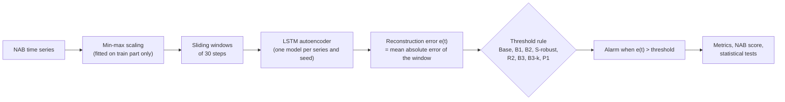

The same pipeline as drawn in the paper (Fig. 2):

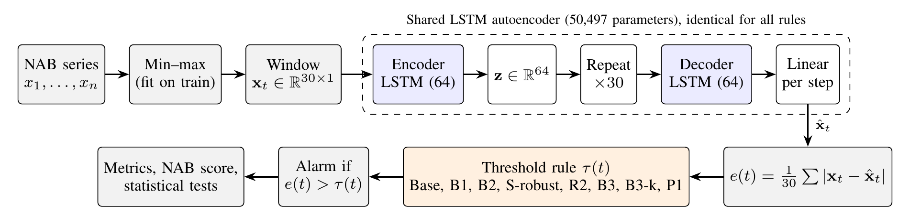

## 3. The data

We use the **Numenta Anomaly Benchmark (NAB)**, a public set of real and
artificial time series with labelled anomaly windows. The version is pinned
to one git commit (`ea702d75`) so anyone gets the same files
([scripts/fetch_nab.sh](../scripts/fetch_nab.sh)).

| | Value |
|---|---|
| Series (files) | 58 in 7 categories |
| Data points | 365,558 |
| Labelled anomaly windows | 116 |
| Share of points inside windows | 9.16 % |
| Series with at least one window | 52 |

Source: [results/phase1_eda/category_summary.csv](../results/phase1_eda/category_summary.csv).
Full exploratory analysis: [phase1_eda.md](phase1_eda.md).

What NAB looks like, one example per category (shaded = anomaly window,
dashed = our split boundaries):

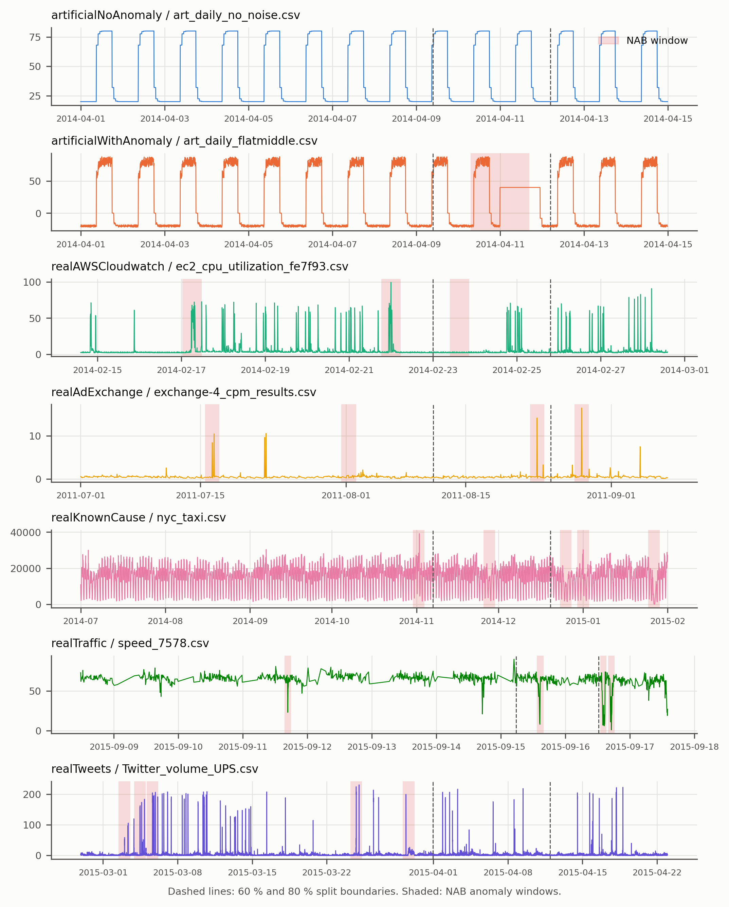

Things we found and handled during the data check:

- No missing values, but 49 duplicate timestamps in 8 files. We keep them,
  because NAB's own scorer scores every row (decision D-19).
- 25 files have irregular time steps. We do not fill the gaps, because NAB
  labels and scores rows, not clock times (D-20).
- Some files are dominated by a few spikes, so most errors will be small and
  a few very large. This is exactly where mean/sd and median/MAD differ most,
  so NAB is a fair test for our idea.

## 4. Splitting each series in time

Each series is cut into three parts **in time order**, never shuffled:

```text
|<----------------- train 60 % ----------------->|<-- val 20 % -->|<-- test 20 % -->|
  model learns here (no labels used)               tune thresholds   score once
```

- **Train (first 60 %)**: the model learns from it. Labels are not used.
- **Validation (next 20 %)**: used only to choose each rule's parameters.
- **Test (last 20 %)**: used once, at the end, to report results.

Time order matters because a real monitor only ever sees the past. If the
parts were shuffled, the model would learn from the future.

**Why train without labels?** A deployed detector does not know where the
anomalies in its history are. The base paper also fits its threshold on all
training errors. The earlier version of this project removed labelled
windows from training, which quietly gave the static rules information a
real system would not have (decision D-04,
[old_vs_new.md](old_vs_new.md) item 4).

## 5. Which series are used for what

Of the 116 windows, only 25 fall in the test part, and they sit in 18
series. Those 18 series are therefore the only ones that can be scored.

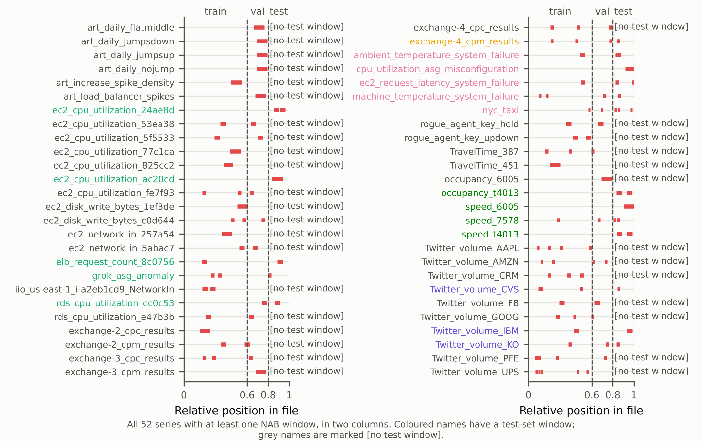

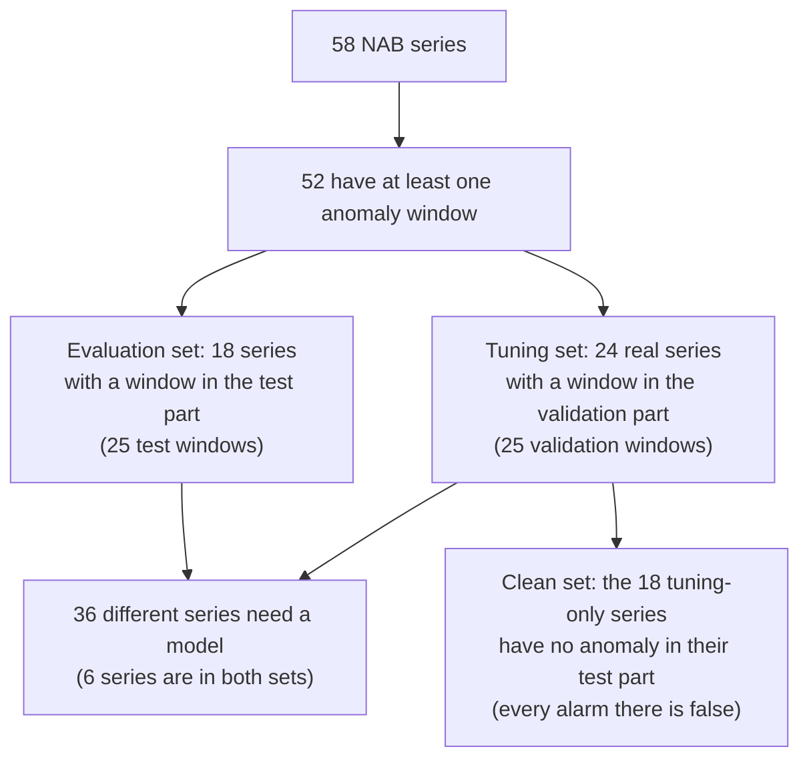

- The 6 series in both sets are safe: their validation and test parts do not
  overlap in time.
- Artificial series are left out of tuning so that tuning matches the
  all-real evaluation set.
- `grok_asg_anomaly` is left out of tuning because one of its windows starts
  in validation and ends in test.

The exact lists are in [configs/datasets.json](../configs/datasets.json),
generated by [scripts/make_selection.py](../scripts/make_selection.py)
(decision D-21).

## 6. The model

The model follows the base paper exactly, except that we use PyTorch instead
of Keras (TensorFlow has no native Windows GPU support after version 2.10;
the architecture is the same, D-11).

| Part | Setting |
|---|---|
| Input | window of 30 steps, 1 value per step |
| Encoder | LSTM with 64 units, keep the last hidden state |
| Bottleneck | that 64-number summary, repeated 30 times |
| Decoder | LSTM with 64 units |
| Output | one linear layer per step, rebuilding the 30 values |
| Size | 50,497 trainable parameters |
| Training | Adam, learning rate 0.001, batch size 32, mean squared error loss |
| Stopping | at most 50 epochs; stop after 5 epochs without improvement on the last 10 % of the training part |
| Repeats | every series trained with 3 seeds (15, 42, 123) |

Each of the 36 series was trained 3 times: **108 models, 0 failures, 47.5
minutes on a laptop CPU**. Epochs run ranged from 6 to 50 (median 20).
Details: [phase2_model.md](phase2_model.md),
[logs/phase2_train.log](../logs/phase2_train.log).

Training curves for four series:

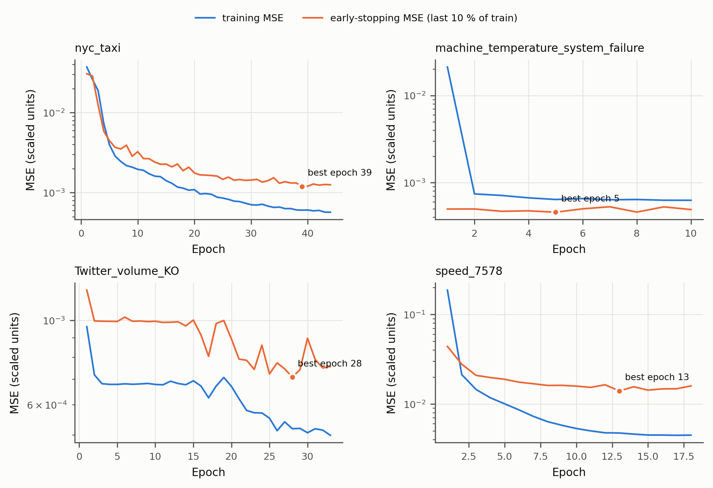

All 108 error series are saved in `results/phase2_errors/`, so every later
step can be rerun without retraining.

## 7. From model output to an anomaly score

For the window that ends at time `t`, the score is the mean absolute
difference between the real 30 values and the rebuilt 30 values:

```text
e(t) = (1/30) * sum over the window of |real value - rebuilt value|
```

The score belongs to the **last** time step of the window, so it only uses
data up to `t`. The first 29 points of each series have no score.

Example: the `nyc_taxi` series and its error. The error rises inside the
shaded anomaly windows, but also at other times, which is why the choice of
threshold matters.

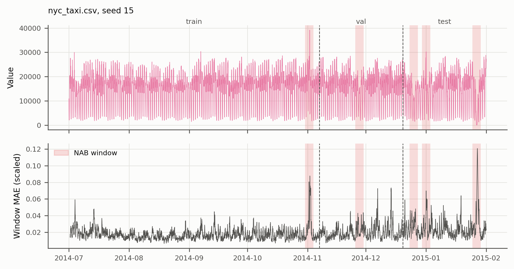

## 8. The eight threshold rules

All rules raise an alarm when `e(t)` is strictly above the threshold.

**Static rules** compute one number from the training errors and keep it
forever:

| Rule | Threshold | Parameter chosen on validation |
|---|---|---|
| **Base** (Ahmad 2026, the base paper) | mean + 3 sd of training errors | none (3 is fixed by the paper) |
| **B1** | p-th percentile of training errors | p |
| **B2** | mean + k sd of training errors | k |
| **S-robust** | median + lambda x scaled MAD of training errors | lambda |
| **R2** (Yu et al. 2024) | extreme value theory: fit a tail curve to the largest training errors | none (chosen from training errors) |

**Rolling rules** recompute the threshold at every step from the last `w`
errors, so they follow the series as it changes:

| Rule | Threshold at time t | Parameters chosen on validation |
|---|---|---|
| **B3** (RePAD2 rule, Lee & Lin 2023) | mean + 3 sd of the previous w errors | w |
| **B3-k** | mean + k sd of the previous w errors | k, w |
| **P1** (our proposal) | median + lambda x scaled MAD of the previous w errors | lambda, w, memory |

How a rolling rule works, step by step:

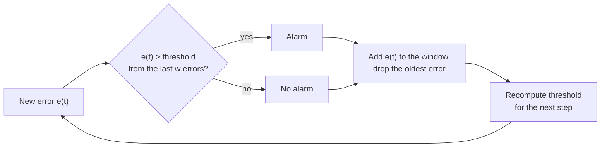

P1 has a second option called **gated memory**: errors that raise an alarm
are kept out of the window, so an anomaly cannot pull the threshold up. If
an alarm run lasts longer than `w` steps, the new level is accepted as
normal. The paper's Algorithm 1 gives the exact steps; the code is
`rolling_alarms` in [pipeline/thresholds.py](../pipeline/thresholds.py).

**Fair comparisons built in.** B2 and S-robust differ only in mean/sd versus
median/MAD (both static, one parameter, same kind of grid). B3-k and P1
differ in the same way (both rolling, same parameters tuned). If robust
statistics help, these pairs should show it.

Two small safety details (decided before any result existed):

- MAD is multiplied by 1.4826 so it is on the same scale as an sd.
- Rolling rules never let their spread fall below a floor of 0.1 x the
  scaled MAD of the training errors, so a perfectly flat stretch does not
  turn every tiny bump into an alarm (D-09).

## 9. Choosing parameters without touching the test data

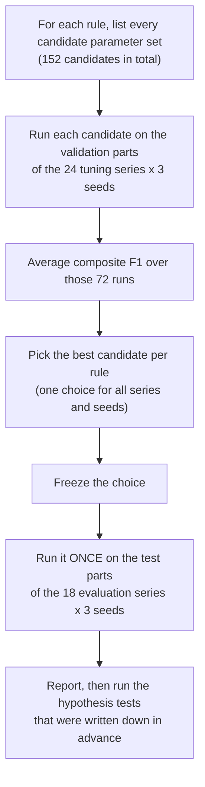

What was selected ([results/phase3/selected_params.csv](../results/phase3/selected_params.csv)):

| Rule | Selected |
|---|---|
| B1 | p = 90 |
| B2 | k = 2.5 |
| S-robust | lambda = 5 |
| B3 | w = 400 |
| B3-k | k = 3, w = 400 (the same as B3) |
| P1 | lambda = 6, w = 50, plain memory |

How the validation score changes with each parameter:

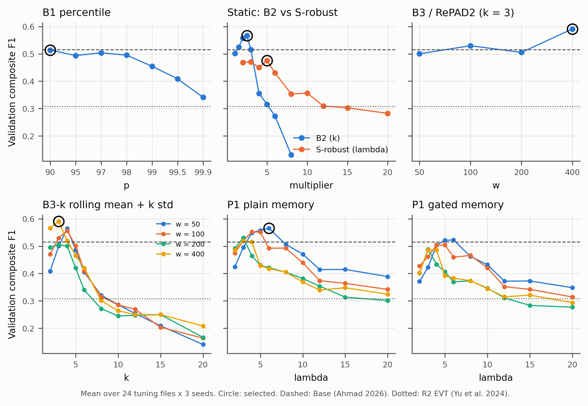

Four choices sat at the edge of their grid. We noticed this only after the
test results were known, so we extended those grids in a separate run that
is clearly labelled **exploratory** (D-27). It did not change P1's choice
and does not replace any primary result
([phase3_thresholds.md](phase3_thresholds.md), "Exploratory").

## 10. How we measure success

| Measure | In plain words | Better |
|---|---|---|
| **Composite F1** (main measure) | combines "how many alarms were real" (precision) with "how many anomaly windows were caught at least once" (event recall) | higher |
| Point F1 | precision and recall counted point by point, without the common "point adjustment" trick that inflates scores | higher |
| Event recall | share of anomaly windows with at least one alarm | higher |
| FPR | share of normal points that raised an alarm | lower |
| High-variance FPR | FPR only on the noisy, high-variance stretches, where our proposal expected the biggest gain | lower |
| Clean-stream false alarms | alarms per 1,000 points on test parts that have no anomaly at all | lower |
| NAB score | NAB's official scoring, which rewards early detection and penalises false alarms; our port of the scorer matches NAB's published results to within 5e-12 | higher |
| Detection delay | how far into a window the first alarm comes (0 = at the start, 1 = at the end) | lower |

Why no point adjustment: it counts a whole window as detected if a single
point is flagged, which makes even random alarms look good (Kim et al. 2022).

Statistics: the unit is one series (the metric averaged over the 3 seeds),
so n = 18. We use the paired Wilcoxon signed-rank test, a bootstrap 95 %
confidence interval for the mean difference, and the Holm correction when
P1 is compared with several rules at once. The hypotheses and tests were
written into [decisions.md](decisions.md) (D-26, D-28) and committed to git
**before** any threshold result existed.

## 11. Results

Test parts of the 18 evaluation series. Mean over the 3 seeds
([results/phase3/test_summary.csv](../results/phase3/test_summary.csv)).

| Rule | Composite F1 | Point F1 | Event recall | FPR | High-var. FPR | Clean false alarms / 1000 |
|---|---|---|---|---|---|---|
| Base (base paper) | 0.733 | 0.355 | 0.972 | 0.189 | 0.231 | 61.5 |
| B1 percentile | 0.587 | 0.407 | 0.972 | 0.319 | 0.488 | 187.3 |
| B2 mean + k sd | 0.718 | 0.371 | 0.972 | 0.199 | 0.250 | 81.1 |
| S-robust | 0.655 | 0.332 | 0.944 | 0.215 | 0.268 | 164.1 |
| R2 EVT | 0.639 | 0.245 | 0.806 | 0.164 | 0.171 | **17.1** |
| B3 rolling mean (RePAD2) | **0.743** | 0.207 | 0.917 | **0.018** | **0.070** | 24.5 |
| B3-k | 0.743 | 0.207 | 0.917 | 0.018 | 0.070 | 24.5 |
| **P1 (proposed)** | 0.544 | 0.161 | 0.769 | 0.035 | 0.080 | 68.2 |

The full table with standard deviations and NAB scores is
[phase3_thresholds.md](phase3_thresholds.md).

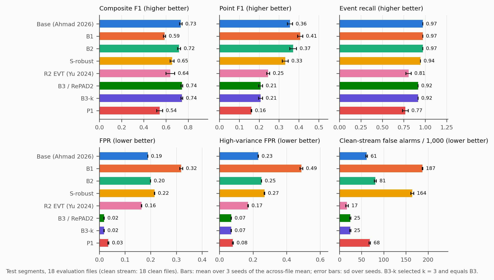

What the table says, in four points:

1. **The base rule finds almost everything but cries wolf.** It caught 24 of
   the 25 test windows, but 18.9 % of normal points raised an alarm.
2. **Rolling rules fix the false alarms.** B3 cut FPR to 1.8 % (about a
   tenth of Base) and P1 to 3.5 % (about a fifth), while B3 kept the best
   composite F1 of all rules.
3. **The robust version did not beat the plain version.** P1 lost to B3 on
   composite F1, event recall and clean-stream false alarms; in the static
   pair, S-robust also had a lower composite F1 than B2.
4. **P1 missed the most windows**: 6.7 of 25 on average, against 1 for the
   static rules and 3 for B3 ([detection delay table](phase3_thresholds.md)).

### Hypothesis tests (decided in advance)

| Hypothesis | Result | Evidence |
|---|---|---|
| H1: P1 has higher composite F1 than Base | **Not supported.** P1 was significantly **worse**: difference -0.190, 95 % CI -0.351 to -0.008, worse on 13 of 18 series, p = 0.035 | [hypothesis_tests.csv](../results/phase3/hypothesis_tests.csv) |
| H2: P1 has lower high-variance FPR than Base | **Not supported.** Lower on average (-0.151) but the test was not significant, p = 0.109 (n = 17) | same file |
| NAB score: P1 differs from Base | No significant difference, p = 0.832 | same file |
| Proposal H1: P1 has higher point F1 on at least 70 % of series | **Not supported** against Base or B3 | [proposal_hypotheses.csv](../results/phase3/proposal_hypotheses.csv) |
| Proposal H2: P1 cuts high-variance FPR by at least 15 % | **Not supported** (against Base the 15 % was met but neither test was significant) | same file |
| Proposal H3: AWS CloudWatch series gain most | **Partly**, descriptively, and only against Base | [category_analysis.csv](../results/phase3/category_analysis.csv) |

Per-series view (each dot is one series; the paper's Fig. 3):

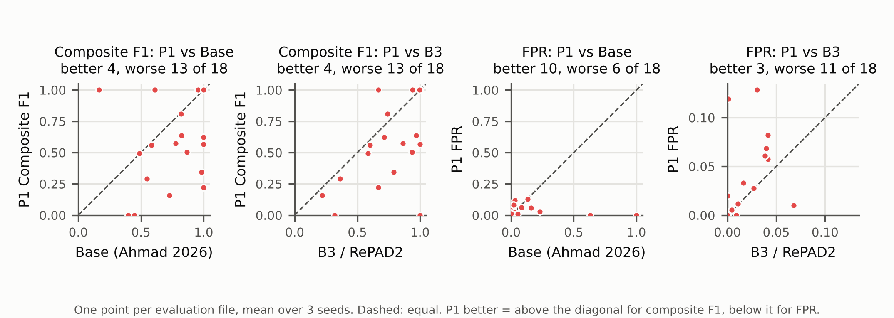

Per category (the paper's Fig. 4; categories have only 1 to 5 series, so
this is descriptive):

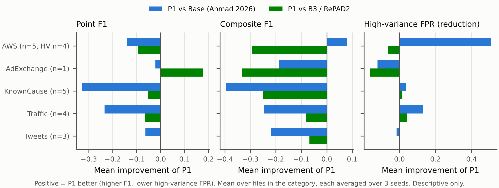

## 12. Why the proposed rule lost

Two findings explain the result.

**The base rule's problem was the opposite of what we expected.** We
expected mean + 3 sd to be too high and miss anomalies. In fact it was too
low on later data: the median test error was 1.20 times the median training
error, and test errors were larger in 17 of the 18 series
([error_drift.csv](../results/phase3/error_drift.csv)). A fixed threshold
fitted on training errors therefore fires too often. Any rule that follows
recent errors fixes this, robust or not.

**Masking moved into P1 itself.** P1 chose a short window (`w = 50`). In 50
steps, an anomaly quickly fills a large share of the window, and then the
median and MAD rise just like a mean would. The threshold climbs with the
anomaly, and the anomaly hides under it. The figure below (the paper's
Fig. 5) shows this on `nyc_taxi`: in the last anomaly window, only 1 error
is above P1's threshold, against 30 for B3 and 73 for Base.

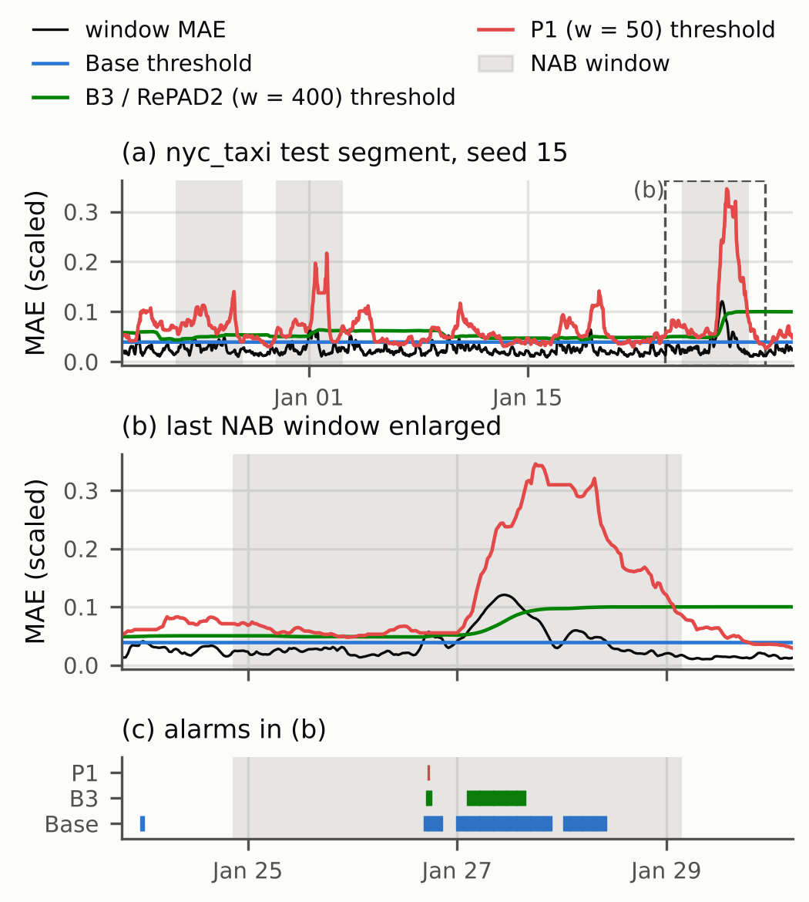

B3 avoids this because it chose a long window (`w = 400`): a short anomaly
barely moves a mean over 400 errors. Gated memory was meant to stop the
masking, but it lost on validation, probably because it also keeps harmless
level shifts out of the window, which then cause long runs of false alarms.

**Take-away for practice:** with an LSTM autoencoder like the base paper's,
the cheapest improvement is to make the threshold rolling, not to make it
robust.

## 13. What we did to keep the study honest

| Risk | What we did | Where to check |
|---|---|---|
| Test data leaking into tuning | Parameters chosen on validation parts only; test scored once | [decisions.md](decisions.md) D-06, D-26 |
| Scaler leakage | Min-max scaler fitted on the training part only | `pipeline/data.py` |
| Labels used in training | Model and training errors use all training data, no label filtering | D-04 |
| Changing the hypotheses after seeing results | Hypotheses committed to git before any threshold result | D-26, D-28, git history |
| Unfair comparison | Every rule uses the same errors; equal tuning budget for the Gaussian and robust pairs (B3-k added for this) | D-26 |
| Wrong NAB numbers | Our scorer reproduces NAB's published results to within 5e-12 | [results/scorer_validation.csv](../results/scorer_validation.csv) |
| Typos in the paper's numbers | A script checks all 306 numeric tokens of the paper against the result files: 0 mismatches | [paper_number_check.md](paper_number_check.md) |
| Code bugs | 45 unit tests | [tests/](../tests) |
| Post-hoc changes passed off as planned | The one post-hoc run is labelled exploratory and kept separate | D-27, `results/phase3_exploratory/` |

What changed compared with the earlier version of this project, and why, is
documented line by line in [old_vs_new.md](old_vs_new.md).

## 14. Limitations

- One model (the base paper's LSTM autoencoder) and one benchmark (NAB).
- Only 25 test windows in 18 series, so confidence intervals are wide.
- NAB itself has known label problems (Wu & Keogh 2023).
- Our NAB scores use a 60/20/20 split and no probationary period, so they
  are not comparable to the NAB leaderboard (D-07).
- B3 and R2 are re-implementations of the published rules on our model's
  errors, not the original systems; R2 covers only the static part of
  Yu et al.'s method (D-24).

## 15. Glossary

| Term | Meaning |
|---|---|
| Autoencoder | A network that compresses its input and rebuilds it; badly rebuilt input is unusual |
| LSTM | A type of recurrent network that handles sequences |
| Reconstruction error | How far the rebuilt window is from the real one |
| Threshold | The error level above which an alarm is raised |
| Static / rolling threshold | Fixed from training errors / recomputed from the last w errors |
| MAD | Median absolute deviation: the median distance of values from their median; a robust spread |
| Robust | Barely affected by a few extreme values |
| Masking | Large anomalous errors raising the threshold so that anomalies stay below it |
| Leakage | Information from the test data reaching training or tuning |
| Pre-registration | Writing the hypotheses and tests down before seeing the results |
| Seed | The starting value for random numbers; different seeds give slightly different models |
| Wilcoxon signed-rank test | A paired test that does not assume normally distributed differences |
| Holm correction | Adjusts p-values when several comparisons are made at once |
